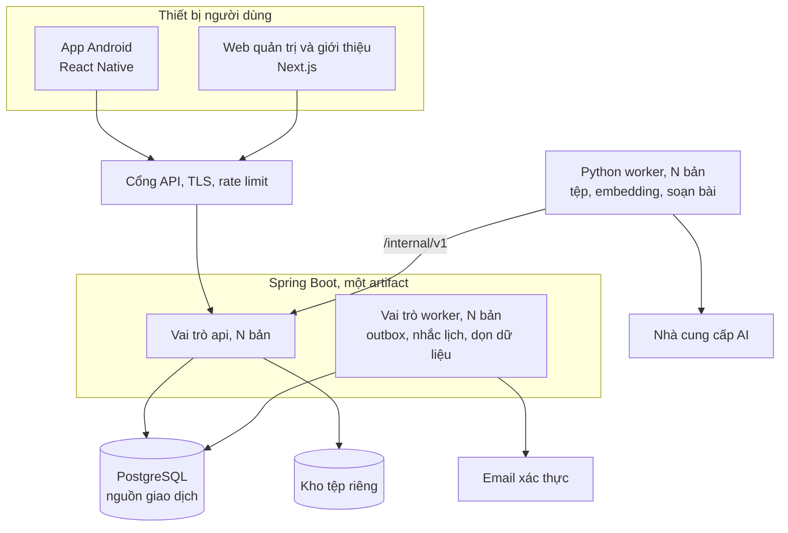

# Kiến trúc TutorBridge

Bản hiện hành, tổng hợp từ thiết kế G3 và các ADR. Khi lệch với [02-kien-truc-bao-mat](02-kien-truc-bao-mat.md), bản này và ADR được ưu tiên.



## Nguyên tắc
| Nguyên tắc | Cách làm | Căn cứ |
|---|---|---|
| Một nơi quyết định | Chỉ Spring kiểm quyền và ghi DB; Python worker không chạm DB | ADR-0005 |
| API không trạng thái | Phiên, khóa, tệp, tác vụ đều ở DB hoặc kho tệp, không ở RAM | NFR15 |
| DB là chốt cuối | Ràng buộc và giao dịch quyết định lịch | ADR-0002 |
| Việc dài chạy nền | Tệp và AI không giữ luồng API | ADR-0003, ADR-0005 |
| Ranh giới mô-đun được kiểm | Test kiến trúc trong CI | ADR-0001 |
| Hợp đồng đi trước | OpenAPI là nguồn cho client | G3-D07-02 |

## Mô-đun
| Mô-đun | Sở hữu | Luồng |
|---|---|---|
| Identity & Profiles | Tài khoản, phiên, hồ sơ, liên kết, xác minh | F01 |
| Matching & Classes | Nhu cầu, gợi ý, đề nghị, lớp, booking | F02, F03 |
| Materials & Planning | Nguồn, quyền, đoạn trích, tác vụ AI, phiên bản duyệt | F04 |
| Learning | Nhật ký, xác nhận, bài tập, tiến trình | F05 |
| Support & Privacy | Vụ việc, quyền tạm, xóa, tombstone | F06 |
| Platform | Outbox, cấu hình, quan sát, quota | Dùng chung |

## Cấu trúc monorepo dự kiến
```text
backend/     Spring Boot, migration Flyway
ai-worker/   Python worker
web/         Next.js
mobile/      React Native, Expo
contracts/   OpenAPI đang dùng, công khai và nội bộ
packages/    API client sinh từ OpenAPI
infra/       Docker Compose, cấu hình môi trường
docs/        Tài liệu này
```

Đường mở rộng theo tải ở [mo-rong.md](mo-rong.md).
