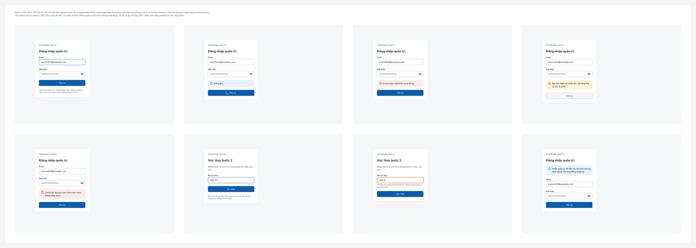

# AD01 Đăng nhập và xác thực quản trị

- **Trạng thái thiết kế:** Đã duyệt v1 (Đính, 10/11/2026)
- **Version Figma:** `Lát 1 v1 2026-11-10` (named version lưu tay trong Figma)
- **Node:** section [39:212](https://www.figma.com/design/uuEo9SH3LxWcFbbHHFFBgl?node-id=39-212)
- **Kênh:** Web
- **Route (đề xuất, Issue giao diện được chỉnh nếu xung đột router):** `/admin/sign-in`
- **Issue giao diện:** Chưa có
- **Căn cứ:** UC01, UC14; FR-02, FR-39, FR-40; đặc tả ở [06-man-hinh-lat-1.md](../06-man-hinh-lat-1.md)
- **API:** `loginAccount`, `completeAdminMfa`

## Ảnh

Ảnh gồm mọi frame trạng thái của section theo thứ tự trong bảng dưới. Xem từng frame ở độ phân giải đầy đủ qua link node.

## Trạng thái

| Frame | Node |
|---|---|
| Đăng nhập quản trị / Mặc định | [39:3](https://www.figma.com/design/uuEo9SH3LxWcFbbHHFFBgl?node-id=39-3) |
| Đăng nhập quản trị / Đang gửi | [39:28](https://www.figma.com/design/uuEo9SH3LxWcFbbHHFFBgl?node-id=39-28) |
| Đăng nhập quản trị / Sai thông tin | [39:60](https://www.figma.com/design/uuEo9SH3LxWcFbbHHFFBgl?node-id=39-60) |
| Đăng nhập quản trị / Bị trì hoãn | [39:91](https://www.figma.com/design/uuEo9SH3LxWcFbbHHFFBgl?node-id=39-91) |
| Đăng nhập quản trị / Tài khoản bị khóa | [39:122](https://www.figma.com/design/uuEo9SH3LxWcFbbHHFFBgl?node-id=39-122) |
| Xác thực bổ sung / Nhập mã | [39:151](https://www.figma.com/design/uuEo9SH3LxWcFbbHHFFBgl?node-id=39-151) |
| Xác thực bổ sung / Mã sai | [39:167](https://www.figma.com/design/uuEo9SH3LxWcFbbHHFFBgl?node-id=39-167) |
| Đăng nhập quản trị / Hết phiên | [39:183](https://www.figma.com/design/uuEo9SH3LxWcFbbHHFFBgl?node-id=39-183) |

Trạng thái chung (tải, lỗi tải, mất quyền, hết phiên, đang gửi, chưa rõ kết quả) theo [04-trang-thai-cau-chu.md](../04-trang-thai-cau-chu.md) khi frame không vẽ riêng.

## Câu chữ

Nguyên văn trong Figma; câu chung lấy từ [04](../04-trang-thai-cau-chu.md). `{…}` là dữ liệu thật thay vào.

| Vị trí | Chuỗi |
|---|---|
| Tiêu đề | TutorBridge, quản trị / Đăng nhập quản trị / Xác thực bước 2 |
| Bước 2 | Nhập mã 6–8 chữ số từ ứng dụng xác thực của bạn. Mã chỉ dùng một lần. Phiên quản trị hết hạn sau 30 phút không hoạt động, tối đa 12 giờ. |
| Lỗi | Email hoặc mật khẩu chưa đúng. / Lỗi: Mã chưa đúng hoặc đã hết hạn. Nhập mã mới từ ứng dụng xác thực. |
| Hết phiên | Phiên quản trị đã hết sau 30 phút không hoạt động. Vui lòng đăng nhập lại. |
| Ghi chú | Tài khoản quản trị do TutorBridge cấp, không tự đăng ký. |
| Nút | Tiếp tục / Xác nhận |
| Lỗi tại ô (Figma không vẽ; Đính duyệt 27/11/2026) | Nhập email. / Email chưa đúng định dạng. / Nhập mật khẩu. / Nhập mã 6–8 chữ số. |
| Tên đọc nút con mắt (Đính duyệt 27/11/2026) | Hiện mật khẩu / Ẩn mật khẩu |

## Hành vi

- challengeToken không hiện, không ghi log.
- Viền focus 2 px primary đặc.
- Bị trì hoãn (429): nút bị vô hiệu tới hết thời gian API báo trong `Retry-After` (không có thì 15 phút), sửa ô không mở lại; hết thời gian thì form tự về trạng thái mặc định.

## Ánh xạ sang code

| Figma | Web |
|---|---|
| `TextField` | `input.tsx`, `form-field.tsx` |
| `Notice` | `notice.tsx` |
| `Button` | `button.tsx` |

## Khác so với đặc tả và câu hỏi còn mở

Đính chốt ngày 27/11/2026 khi so ảnh web thật với frame (#253):
- Nền trang xám nhạt và thẻ trắng không viền theo frame, nhưng thẻ **căn giữa** thay vì lệch trái như vị trí trong frame.
- Dòng "Tài khoản quản trị do TutorBridge cấp…" chỉ ở trạng thái mặc định, như frame.
- Nút khi bị trì hoãn dùng **kiểu vô hiệu chung** của `Button` (đã duyệt 22/11), không dùng nút viền xám của frame.
- Ô mã giữ đúng chữ số người dùng gõ, không tự chèn dấu cách; "482 913" trong frame chỉ là ví dụ hiển thị.
