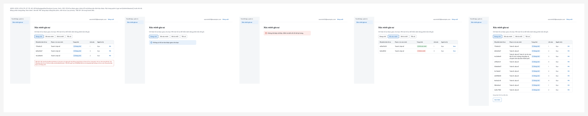

# AD03 Hàng chờ xác minh gia sư

- **Trạng thái thiết kế:** Đã duyệt v1 (Đính, 10/11/2026); khung TBD chưa duyệt
- **Version Figma:** `Lát 1 v1 2026-11-10` (named version lưu tay trong Figma)
- **Node:** section [40:435](https://www.figma.com/design/uuEo9SH3LxWcFbbHHFFBgl?node-id=40-435)
- **Kênh:** Web
- **Route (đề xuất, Issue giao diện được chỉnh nếu xung đột router):** `/admin/verifications`
- **Issue giao diện:** Chưa có
- **Căn cứ:** UC03, UC14; FR-07, FR-40; đặc tả ở [06-man-hinh-lat-1.md](../06-man-hinh-lat-1.md)
- **API:** `listAssignedVerifications`

## Ảnh

Ảnh gồm mọi frame trạng thái của section theo thứ tự trong bảng dưới. Xem từng frame ở độ phân giải đầy đủ qua link node.

## Trạng thái

| Frame | Node |
|---|---|
| Hàng chờ xác minh / Có hồ sơ | [40:122](https://www.figma.com/design/uuEo9SH3LxWcFbbHHFFBgl?node-id=40-122) |
| Hàng chờ xác minh / Rỗng | [40:188](https://www.figma.com/design/uuEo9SH3LxWcFbbHHFFBgl?node-id=40-188) |
| Hàng chờ xác minh / Lỗi tải | [40:218](https://www.figma.com/design/uuEo9SH3LxWcFbbHHFFBgl?node-id=40-218) |
| Hàng chờ xác minh / Đã xác minh | [40:238](https://www.figma.com/design/uuEo9SH3LxWcFbbHHFFBgl?node-id=40-238) |
| Hàng chờ xác minh / Dữ liệu xấu nhất | [40:292](https://www.figma.com/design/uuEo9SH3LxWcFbbHHFFBgl?node-id=40-292) |

Trạng thái chung (tải, lỗi tải, mất quyền, hết phiên, đang gửi, chưa rõ kết quả) theo [04-trang-thai-cau-chu.md](../04-trang-thai-cau-chu.md) khi frame không vẽ riêng.

## Câu chữ

Nguyên văn trong Figma; câu chung lấy từ [04](../04-trang-thai-cau-chu.md). `{…}` là dữ liệu thật thay vào.

| Vị trí | Chuỗi |
|---|---|
| Tiêu đề | Xác minh gia sư |
| Dẫn | Chỉ hiện hồ sơ được giao cho bạn. Mở một hồ sơ để thẩm định đúng phiên bản đã gửi. |
| Lọc | Đang chờ / Đã xác minh / Đã từ chối / Tất cả |
| Cột | Mã phiên bản hồ sơ / Phạm vi xin xác minh / Trạng thái / Lần sửa / Người xử lý / Mở |
| Rỗng | Không có hồ sơ nào được giao cho bạn. |

## Hành vi

- Gọi verifyAdminSession() trước khi tải.
- "Xem thêm" theo cursor; liên kết Mở dùng được bằng bàn phím.

## Ánh xạ sang code

| Figma | Web |
|---|---|
| `StatusLabel` | Chưa có trong code, thêm ở Issue giao diện đầu tiên dùng nó (`shared/ui`) |
| `Notice` | `notice.tsx` |
| `Button` | `button.tsx` |

## Khác so với đặc tả và câu hỏi còn mở

- OP-28 đã đóng (#98, 21/11/2026): hợp đồng có `tutorDisplayName`, `submittedAt`, tham số `status` (`PENDING`, `VERIFIED`, `REJECTED`, bỏ trống là Tất cả), `reason` (PENDING kèm lý do là "cần bổ sung") và `superseded`. TBD (Đính): vẽ AD03 v2 có cột tên gia sư, ngày gửi và cách hiện "cần bổ sung", phiếu bị thay; lưu named version.
