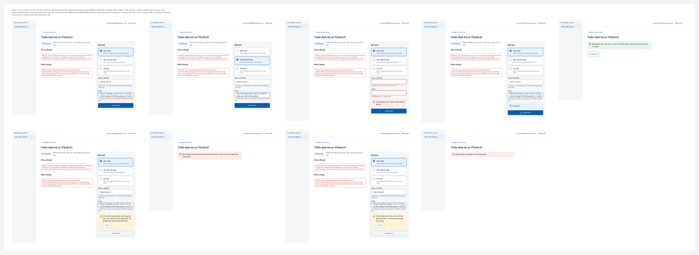

# AD04 Thẩm định hồ sơ và minh chứng

- **Trạng thái thiết kế:** Đã duyệt v1 (Đính, 10/11/2026); khung TBD chưa duyệt
- **Version Figma:** `Lát 1 v1 2026-11-10` (named version lưu tay trong Figma)
- **Node:** section [41:675](https://www.figma.com/design/uuEo9SH3LxWcFbbHHFFBgl?node-id=41-675)
- **Kênh:** Web
- **Route (đề xuất, Issue giao diện được chỉnh nếu xung đột router):** `/admin/verifications/[verificationId]`
- **Issue giao diện:** Chưa có
- **Căn cứ:** UC03, UC14; FR-07, FR-40; AC-UC03-02; đặc tả ở [06-man-hinh-lat-1.md](../06-man-hinh-lat-1.md)
- **API:** `getAssignedVerification`, `decideVerification`, `readAssignedEvidence`

## Ảnh

Ảnh gồm mọi frame trạng thái của section theo thứ tự trong bảng dưới. Xem từng frame ở độ phân giải đầy đủ qua link node.

## Trạng thái

| Frame | Node |
|---|---|
| Thẩm định / Mặc định | [41:181](https://www.figma.com/design/uuEo9SH3LxWcFbbHHFFBgl?node-id=41-181) |
| Thẩm định / Yêu cầu bổ sung | [41:248](https://www.figma.com/design/uuEo9SH3LxWcFbbHHFFBgl?node-id=41-248) |
| Thẩm định / Lỗi trường | [41:314](https://www.figma.com/design/uuEo9SH3LxWcFbbHHFFBgl?node-id=41-314) |
| Thẩm định / Đang gửi | [41:389](https://www.figma.com/design/uuEo9SH3LxWcFbbHHFFBgl?node-id=41-389) |
| Thẩm định / Đã ghi | [41:464](https://www.figma.com/design/uuEo9SH3LxWcFbbHHFFBgl?node-id=41-464) |
| Thẩm định / Bản cũ | [41:488](https://www.figma.com/design/uuEo9SH3LxWcFbbHHFFBgl?node-id=41-488) |
| Thẩm định / Hồ sơ của chính bạn | [41:562](https://www.figma.com/design/uuEo9SH3LxWcFbbHHFFBgl?node-id=41-562) |
| Thẩm định / Chưa rõ kết quả | [41:582](https://www.figma.com/design/uuEo9SH3LxWcFbbHHFFBgl?node-id=41-582) |
| Thẩm định / Không còn được giao | [41:655](https://www.figma.com/design/uuEo9SH3LxWcFbbHHFFBgl?node-id=41-655) |

Trạng thái chung (tải, lỗi tải, mất quyền, hết phiên, đang gửi, chưa rõ kết quả) theo [04-trang-thai-cau-chu.md](../04-trang-thai-cau-chu.md) khi frame không vẽ riêng.

## Câu chữ

Nguyên văn trong Figma; câu chung lấy từ [04](../04-trang-thai-cau-chu.md). `{…}` là dữ liệu thật thay vào.

| Vị trí | Chuỗi |
|---|---|
| Tiêu đề | Thẩm định hồ sơ {mã} |
| Kết quả | Xác minh (Minh chứng đủ cho phạm vi ghi dưới đây.) / Yêu cầu bổ sung (Hồ sơ vẫn chờ; gia sư cần gửi thêm.) / Từ chối (Minh chứng không đủ cho phạm vi xin xác minh.) |
| Ô | Phạm vi đã kiểm (1–200 ký tự. Ghi đúng phạm vi đã kiểm, không dùng từ "đảm bảo".) / Lý do (1–2.000 ký tự. Được lưu cùng người, thời điểm và phiên bản.) |
| Đã ghi | Đã ghi kết quả: Xác minh, phạm vi Toán 8, đại số. Hồ sơ đã rời hàng chờ của bạn. |
| Bản cũ | Hồ sơ đã có phiên bản mới trong lúc bạn xem. Kết quả chưa được ghi. Tải lại để thẩm định đúng phiên bản. |
| Tự duyệt | Bạn không thể thẩm định hồ sơ của chính mình. Hồ sơ này cần người xác minh khác. |
| Nút | Ghi kết quả / Về hàng chờ |

## Hành vi

- Gửi If-Match và Idempotency-Key; NEEDS_INFO giữ PENDING kèm lý do.

## Ánh xạ sang code

| Figma | Web |
|---|---|
| `ChoiceOption` | Chưa có trong code, thêm ở Issue giao diện đầu tiên dùng nó (`shared/ui`) |
| `TextField` | `input.tsx`, `form-field.tsx` |
| `StatusLabel` | Chưa có trong code, thêm ở Issue giao diện đầu tiên dùng nó (`shared/ui`) |
| `Notice` | `notice.tsx` |
| `Button` | `button.tsx` |

## Khác so với đặc tả và câu hỏi còn mở

- OP-28 đã đóng (#98, 21/11/2026): `getAssignedVerification` trả bản hồ sơ đã gửi đúng phiên bản và danh sách minh chứng (id, loại, dung lượng); mở từng tệp bằng `readAssignedEvidence`. TBD (Đính): vẽ AD04 v2 có khối nội dung hồ sơ và danh sách minh chứng; lưu named version.
