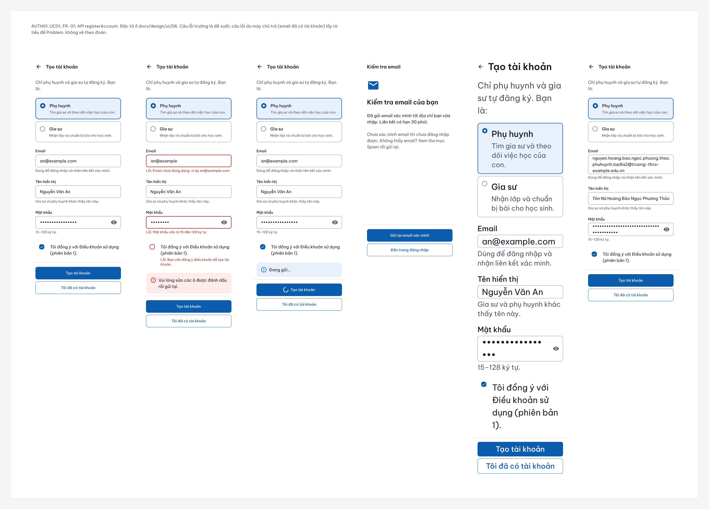

# AUTH01 Đăng ký và chọn vai trò

- **Trạng thái thiết kế:** Đã duyệt v1 (Đính, 10/11/2026)
- **Version Figma:** `Lát 1 v1 2026-11-10` (named version lưu tay trong Figma)
- **Node:** section [9:330](https://www.figma.com/design/uuEo9SH3LxWcFbbHHFFBgl?node-id=9-330)
- **Kênh:** Android
- **Route (đề xuất, Issue giao diện được chỉnh nếu xung đột router):** `/sign-up` (nhóm `(auth)`)
- **Issue giao diện:** TB-10
- **Căn cứ:** UC01; FR-01; đặc tả ở [06-man-hinh-lat-1.md](../06-man-hinh-lat-1.md)
- **API:** `registerAccount`

## Ảnh

Ảnh gồm mọi frame trạng thái của section theo thứ tự trong bảng dưới. Xem từng frame ở độ phân giải đầy đủ qua link node.

## Trạng thái

| Frame | Node |
|---|---|
| Đăng ký / Mặc định | [9:2](https://www.figma.com/design/uuEo9SH3LxWcFbbHHFFBgl?node-id=9-2) |
| Đăng ký / Lỗi trường | [9:65](https://www.figma.com/design/uuEo9SH3LxWcFbbHHFFBgl?node-id=9-65) |
| Đăng ký / Đang gửi | [9:133](https://www.figma.com/design/uuEo9SH3LxWcFbbHHFFBgl?node-id=9-133) |
| Đăng ký / Đã tạo, chờ xác minh | [9:203](https://www.figma.com/design/uuEo9SH3LxWcFbbHHFFBgl?node-id=9-203) |
| Đăng ký / Dữ liệu xấu nhất | [9:272](https://www.figma.com/design/uuEo9SH3LxWcFbbHHFFBgl?node-id=9-272) |
| Đăng ký / Chữ 200% | [10:243](https://www.figma.com/design/uuEo9SH3LxWcFbbHHFFBgl?node-id=10-243) |

Trạng thái chung (tải, lỗi tải, mất quyền, hết phiên, đang gửi, chưa rõ kết quả) theo [04-trang-thai-cau-chu.md](../04-trang-thai-cau-chu.md) khi frame không vẽ riêng.

## Câu chữ

Nguyên văn trong Figma; câu chung lấy từ [04](../04-trang-thai-cau-chu.md). `{…}` là dữ liệu thật thay vào.

| Vị trí | Chuỗi |
|---|---|
| Tiêu đề | Tạo tài khoản |
| Dẫn | Chỉ phụ huynh và gia sư tự đăng ký. Bạn là: |
| Vai trò | Phụ huynh: Tìm gia sư và theo dõi việc học của con. / Gia sư: Nhận lớp và chuẩn bị bài cho học sinh. |
| Gợi ý email | Dùng để đăng nhập và nhận liên kết xác minh. |
| Gợi ý tên | Gia sư và phụ huynh khác thấy tên này. |
| Gợi ý mật khẩu | 15–128 ký tự. |
| Điều khoản | Tôi đồng ý với Điều khoản sử dụng (phiên bản 1). |
| Nút | Tạo tài khoản / Tôi đã có tài khoản |
| Lỗi | Lỗi: Email chưa đúng dạng, ví dụ an@example.com. / Lỗi: Mật khẩu cần từ 15 đến 128 ký tự. / Lỗi: Bạn cần đồng ý điều khoản để tạo tài khoản. |
| Đã tạo | Kiểm tra email của bạn. Đã gửi email xác minh tới địa chỉ bạn vừa nhập. Liên kết có hạn 30 phút. Nút: Gửi lại email xác minh / Đến trang đăng nhập |

## Hành vi

- Chọn vai trò bằng thẻ chọn một; máy chủ gán vai trò theo danh sách cho phép.
- Nút hiện mật khẩu có nhãn trợ năng "Hiện mật khẩu".
- Lỗi do máy chủ trả (email đã có tài khoản) lấy tiêu đề Problem, không tự viết.

## Ánh xạ sang code

| Figma | Mobile |
|---|---|
| `TopAppBar` | Chưa có trong code, thêm ở Issue giao diện đầu tiên dùng nó (`shared/ui`) |
| `ChoiceOption` | Chưa có trong code, thêm ở Issue giao diện đầu tiên dùng nó (`shared/ui`) |
| `TextField` | `TextField.tsx`, `FormTextField` |
| `Checkbox` | Chưa có trong code, thêm ở Issue giao diện đầu tiên dùng nó (`shared/ui`) |
| `StickyActionBar` | Chưa có trong code, thêm ở Issue giao diện đầu tiên dùng nó (`shared/ui`) |
| `Notice` | `Notice.tsx` |
| `Button` | `Button.tsx` (variant, busy, disabled) |

## Khác so với đặc tả và câu hỏi còn mở

Không có.
