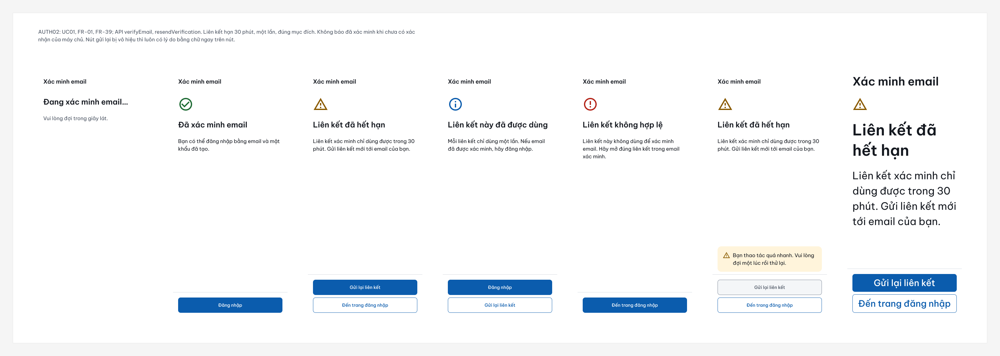

# AUTH02 Xác minh email

- **Trạng thái thiết kế:** Đã duyệt v1 (Đính, 10/11/2026)
- **Version Figma:** `Lát 1 v1 2026-11-10` (named version lưu tay trong Figma)
- **Node:** section [11:316](https://www.figma.com/design/uuEo9SH3LxWcFbbHHFFBgl?node-id=11-316)
- **Kênh:** Android
- **Route (đề xuất, Issue giao diện được chỉnh nếu xung đột router):** `/verify-email` (mở từ liên kết)
- **Issue giao diện:** TB-10
- **Căn cứ:** UC01; FR-01, FR-39; đặc tả ở [06-man-hinh-lat-1.md](../06-man-hinh-lat-1.md)
- **API:** `verifyEmail`, `resendVerification`

## Ảnh

Ảnh gồm mọi frame trạng thái của section theo thứ tự trong bảng dưới. Xem từng frame ở độ phân giải đầy đủ qua link node.

## Trạng thái

| Frame | Node |
|---|---|
| Xác minh email / Đang xác minh | [11:190](https://www.figma.com/design/uuEo9SH3LxWcFbbHHFFBgl?node-id=11-190) |
| Xác minh email / Đã xác minh | [11:199](https://www.figma.com/design/uuEo9SH3LxWcFbbHHFFBgl?node-id=11-199) |
| Xác minh email / Liên kết hết hạn | [11:214](https://www.figma.com/design/uuEo9SH3LxWcFbbHHFFBgl?node-id=11-214) |
| Xác minh email / Liên kết đã dùng | [11:230](https://www.figma.com/design/uuEo9SH3LxWcFbbHHFFBgl?node-id=11-230) |
| Xác minh email / Sai mục đích | [11:246](https://www.figma.com/design/uuEo9SH3LxWcFbbHHFFBgl?node-id=11-246) |
| Xác minh email / Gửi lại bị giới hạn | [11:260](https://www.figma.com/design/uuEo9SH3LxWcFbbHHFFBgl?node-id=11-260) |
| Xác minh email / Chữ 200% | [11:287](https://www.figma.com/design/uuEo9SH3LxWcFbbHHFFBgl?node-id=11-287) |

Trạng thái chung (tải, lỗi tải, mất quyền, hết phiên, đang gửi, chưa rõ kết quả) theo [04-trang-thai-cau-chu.md](../04-trang-thai-cau-chu.md) khi frame không vẽ riêng.

## Câu chữ

Nguyên văn trong Figma; câu chung lấy từ [04](../04-trang-thai-cau-chu.md). `{…}` là dữ liệu thật thay vào.

| Vị trí | Chuỗi |
|---|---|
| Đang xác minh | Đang xác minh email… |
| Đã xác minh | Đã xác minh email. Bạn có thể đăng nhập bằng email và mật khẩu đã tạo. Nút: Đăng nhập |
| Hết hạn | Liên kết đã hết hạn. Liên kết xác minh chỉ dùng được trong 30 phút. Gửi liên kết mới tới email của bạn. Nút: Gửi lại liên kết / Đến trang đăng nhập |
| Đã dùng | Liên kết này đã được dùng. Mỗi liên kết chỉ dùng một lần. Nếu email đã được xác minh, hãy đăng nhập. |
| Sai mục đích | Liên kết không hợp lệ. Liên kết này không dùng để xác minh email. |
| Giới hạn | Bạn thao tác quá nhanh. Vui lòng đợi một lúc rồi thử lại. (nút gửi lại vô hiệu, lý do hiện ngay trên nút) |

## Hành vi

- Không báo đã xác minh khi chưa có xác nhận của máy chủ.

## Ánh xạ sang code

| Figma | Mobile |
|---|---|
| `TopAppBar` | Chưa có trong code, thêm ở Issue giao diện đầu tiên dùng nó (`shared/ui`) |
| `StickyActionBar` | Chưa có trong code, thêm ở Issue giao diện đầu tiên dùng nó (`shared/ui`) |
| `Notice` | `Notice.tsx` |
| `Button` | `Button.tsx` (variant, busy, disabled) |

## Khác so với đặc tả và câu hỏi còn mở

Không có.
