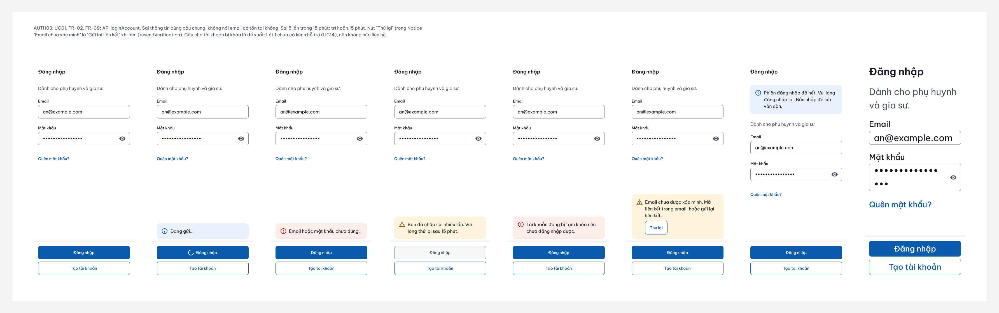

# AUTH03 Đăng nhập

- **Trạng thái thiết kế:** Đã duyệt v1 (Đính, 10/11/2026)
- **Version Figma:** `Lát 1 v1 2026-11-10` (named version lưu tay trong Figma)
- **Node:** section [12:691](https://www.figma.com/design/uuEo9SH3LxWcFbbHHFFBgl?node-id=12-691)
- **Kênh:** Android
- **Route (đề xuất, Issue giao diện được chỉnh nếu xung đột router):** `/sign-in`
- **Issue giao diện:** TB-10
- **Căn cứ:** UC01; FR-02, FR-39; đặc tả ở [06-man-hinh-lat-1.md](../06-man-hinh-lat-1.md)
- **API:** `loginAccount`

## Ảnh

Ảnh gồm mọi frame trạng thái của section theo thứ tự trong bảng dưới. Xem từng frame ở độ phân giải đầy đủ qua link node.

## Trạng thái

| Frame | Node |
|---|---|
| Đăng nhập / Mặc định | [12:361](https://www.figma.com/design/uuEo9SH3LxWcFbbHHFFBgl?node-id=12-361) |
| Đăng nhập / Đang gửi | [12:392](https://www.figma.com/design/uuEo9SH3LxWcFbbHHFFBgl?node-id=12-392) |
| Đăng nhập / Sai thông tin | [12:434](https://www.figma.com/design/uuEo9SH3LxWcFbbHHFFBgl?node-id=12-434) |
| Đăng nhập / Bị trì hoãn | [12:474](https://www.figma.com/design/uuEo9SH3LxWcFbbHHFFBgl?node-id=12-474) |
| Đăng nhập / Tài khoản bị khóa | [12:514](https://www.figma.com/design/uuEo9SH3LxWcFbbHHFFBgl?node-id=12-514) |
| Đăng nhập / Email chưa xác minh | [12:553](https://www.figma.com/design/uuEo9SH3LxWcFbbHHFFBgl?node-id=12-553) |
| Đăng nhập / Hết phiên | [12:592](https://www.figma.com/design/uuEo9SH3LxWcFbbHHFFBgl?node-id=12-592) |
| Đăng nhập / Chữ 200% | [12:630](https://www.figma.com/design/uuEo9SH3LxWcFbbHHFFBgl?node-id=12-630) |

Trạng thái chung (tải, lỗi tải, mất quyền, hết phiên, đang gửi, chưa rõ kết quả) theo [04-trang-thai-cau-chu.md](../04-trang-thai-cau-chu.md) khi frame không vẽ riêng.

## Câu chữ

Nguyên văn trong Figma; câu chung lấy từ [04](../04-trang-thai-cau-chu.md). `{…}` là dữ liệu thật thay vào.

| Vị trí | Chuỗi |
|---|---|
| Tiêu đề | Đăng nhập |
| Dẫn | Dành cho phụ huynh và gia sư. |
| Liên kết | Quên mật khẩu? |
| Nút | Đăng nhập / Tạo tài khoản |
| Sai thông tin | Email hoặc mật khẩu chưa đúng. |
| Trì hoãn | Bạn đã nhập sai nhiều lần. Vui lòng thử lại sau 15 phút. |
| Bị khóa | Tài khoản đang bị tạm khóa nên chưa đăng nhập được. |
| Chưa xác minh | Email chưa được xác minh. Mở liên kết trong email, hoặc gửi lại liên kết. (nút trong Notice: Gửi lại liên kết) |
| Hết phiên | Phiên đăng nhập đã hết. Vui lòng đăng nhập lại. Bản nháp đã lưu vẫn còn. |

## Hành vi

- Câu sai thông tin không nói email có tồn tại hay không.
- Sau đăng nhập đi tới /parent hoặc /tutor theo vai trò máy chủ trả.

## Ánh xạ sang code

| Figma | Mobile |
|---|---|
| `TopAppBar` | Chưa có trong code, thêm ở Issue giao diện đầu tiên dùng nó (`shared/ui`) |
| `TextField` | `TextField.tsx`, `FormTextField` |
| `StickyActionBar` | Chưa có trong code, thêm ở Issue giao diện đầu tiên dùng nó (`shared/ui`) |
| `Notice` | `Notice.tsx` |
| `Button` | `Button.tsx` (variant, busy, disabled) |

## Khác so với đặc tả và câu hỏi còn mở

Không có.
