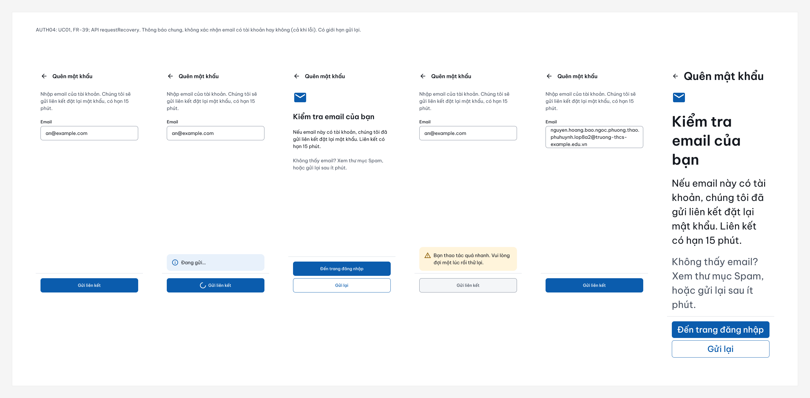

# AUTH04 Yêu cầu khôi phục mật khẩu

- **Trạng thái thiết kế:** Đã duyệt v1 (Đính, 10/11/2026)
- **Version Figma:** `Lát 1 v1 2026-11-10` (named version lưu tay trong Figma)
- **Node:** section [11:484](https://www.figma.com/design/uuEo9SH3LxWcFbbHHFFBgl?node-id=11-484)
- **Kênh:** Android
- **Route (đề xuất, Issue giao diện được chỉnh nếu xung đột router):** `/forgot-password`
- **Issue giao diện:** TB-10
- **Căn cứ:** UC01; FR-39; đặc tả ở [06-man-hinh-lat-1.md](../06-man-hinh-lat-1.md)
- **API:** `requestRecovery`

## Ảnh

Ảnh gồm mọi frame trạng thái của section theo thứ tự trong bảng dưới. Xem từng frame ở độ phân giải đầy đủ qua link node.

## Trạng thái

| Frame | Node |
|---|---|
| Quên mật khẩu / Mặc định | [11:318](https://www.figma.com/design/uuEo9SH3LxWcFbbHHFFBgl?node-id=11-318) |
| Quên mật khẩu / Đang gửi | [11:340](https://www.figma.com/design/uuEo9SH3LxWcFbbHHFFBgl?node-id=11-340) |
| Quên mật khẩu / Đã gửi | [11:373](https://www.figma.com/design/uuEo9SH3LxWcFbbHHFFBgl?node-id=11-373) |
| Quên mật khẩu / Giới hạn gửi lại | [11:393](https://www.figma.com/design/uuEo9SH3LxWcFbbHHFFBgl?node-id=11-393) |
| Quên mật khẩu / Dữ liệu xấu nhất | [11:424](https://www.figma.com/design/uuEo9SH3LxWcFbbHHFFBgl?node-id=11-424) |
| Quên mật khẩu / Chữ 200% | [11:446](https://www.figma.com/design/uuEo9SH3LxWcFbbHHFFBgl?node-id=11-446) |

Trạng thái chung (tải, lỗi tải, mất quyền, hết phiên, đang gửi, chưa rõ kết quả) theo [04-trang-thai-cau-chu.md](../04-trang-thai-cau-chu.md) khi frame không vẽ riêng.

## Câu chữ

Nguyên văn trong Figma; câu chung lấy từ [04](../04-trang-thai-cau-chu.md). `{…}` là dữ liệu thật thay vào.

| Vị trí | Chuỗi |
|---|---|
| Tiêu đề | Quên mật khẩu |
| Dẫn | Nhập email của tài khoản. Chúng tôi sẽ gửi liên kết đặt lại mật khẩu, có hạn 15 phút. |
| Nút | Gửi liên kết |
| Đã gửi | Kiểm tra email của bạn. Nếu email này có tài khoản, chúng tôi đã gửi liên kết đặt lại mật khẩu. Liên kết có hạn 15 phút. Không thấy email? Xem thư mục Spam, hoặc gửi lại sau ít phút. |
| Giới hạn | Bạn thao tác quá nhanh. Vui lòng đợi một lúc rồi thử lại. |

## Hành vi

- Không xác nhận email có tài khoản, kể cả khi lỗi.

## Ánh xạ sang code

| Figma | Mobile |
|---|---|
| `TopAppBar` | Chưa có trong code, thêm ở Issue giao diện đầu tiên dùng nó (`shared/ui`) |
| `TextField` | `TextField.tsx`, `FormTextField` |
| `StickyActionBar` | Chưa có trong code, thêm ở Issue giao diện đầu tiên dùng nó (`shared/ui`) |
| `Notice` | `Notice.tsx` |
| `Button` | `Button.tsx` (variant, busy, disabled) |

## Khác so với đặc tả và câu hỏi còn mở

Không có.
