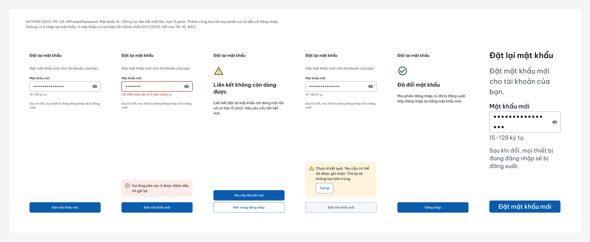

# AUTH05 Đặt lại mật khẩu

- **Trạng thái thiết kế:** Đã duyệt v2 (10/11/2026): v1 bỏ ô nhập lại mật khẩu theo quyết định của Đính ở Q9 của TB-10 (#91)
- **Version Figma:** `Lát 1 v1 2026-11-10` cộng sửa AUTH05 cùng ngày; Đính lưu named version `AUTH05 v2 2026-11-10` (lưu tay)
- **Node:** section [11:673](https://www.figma.com/design/uuEo9SH3LxWcFbbHHFFBgl?node-id=11-673)
- **Kênh:** Android
- **Route (đề xuất, Issue giao diện được chỉnh nếu xung đột router):** `/reset-password` (mở từ liên kết)
- **Issue giao diện:** TB-10
- **Căn cứ:** UC01; FR-39; đặc tả ở [06-man-hinh-lat-1.md](../06-man-hinh-lat-1.md)
- **API:** `resetPassword`

## Ảnh

Ảnh v1 (còn ô nhập lại, đã bỏ): `img/AUTH05-v1.png`.

Ảnh gồm mọi frame trạng thái của section theo thứ tự trong bảng dưới. Xem từng frame ở độ phân giải đầy đủ qua link node.

## Trạng thái

| Frame | Node |
|---|---|
| Đặt lại mật khẩu / Mặc định | [11:486](https://www.figma.com/design/uuEo9SH3LxWcFbbHHFFBgl?node-id=11-486) |
| Đặt lại mật khẩu / Lỗi trường | [11:514](https://www.figma.com/design/uuEo9SH3LxWcFbbHHFFBgl?node-id=11-514) |
| Đặt lại mật khẩu / Liên kết hết hạn hoặc đã dùng | [11:551](https://www.figma.com/design/uuEo9SH3LxWcFbbHHFFBgl?node-id=11-551) |
| Đặt lại mật khẩu / Chưa rõ kết quả | [11:567](https://www.figma.com/design/uuEo9SH3LxWcFbbHHFFBgl?node-id=11-567) |
| Đặt lại mật khẩu / Đã đổi | [11:604](https://www.figma.com/design/uuEo9SH3LxWcFbbHHFFBgl?node-id=11-604) |
| Đặt lại mật khẩu / Chữ 200% | [11:618](https://www.figma.com/design/uuEo9SH3LxWcFbbHHFFBgl?node-id=11-618) |

Trạng thái chung (tải, lỗi tải, mất quyền, hết phiên, đang gửi, chưa rõ kết quả) theo [04-trang-thai-cau-chu.md](../04-trang-thai-cau-chu.md) khi frame không vẽ riêng.

## Câu chữ

Nguyên văn trong Figma; câu chung lấy từ [04](../04-trang-thai-cau-chu.md). `{…}` là dữ liệu thật thay vào.

| Vị trí | Chuỗi |
|---|---|
| Dẫn | Đặt mật khẩu mới cho tài khoản của bạn. |
| Ô | Mật khẩu mới (15–128 ký tự.), có nút hiện/ẩn mật khẩu |
| Ghi chú | Sau khi đổi, mọi thiết bị đang đăng nhập sẽ bị đăng xuất. |
| Nút | Đặt mật khẩu mới |
| Lỗi | Lỗi: Mật khẩu cần từ 15 đến 128 ký tự. |
| Hết hạn | Liên kết không còn dùng được. Liên kết đặt lại mật khẩu chỉ dùng một lần và có hạn 15 phút. Hãy yêu cầu liên kết mới. |
| Đã đổi | Đã đổi mật khẩu. Mọi phiên đăng nhập cũ đã bị đăng xuất. Hãy đăng nhập lại bằng mật khẩu mới. |

## Hành vi

- Không có ô nhập lại mật khẩu; người dùng kiểm bằng nút hiện/ẩn (Đính chốt 10/11/2026, Q9 của TB-10, #91).

## Ánh xạ sang code

| Figma | Mobile |
|---|---|
| `TopAppBar` | Chưa có trong code, thêm ở Issue giao diện đầu tiên dùng nó (`shared/ui`) |
| `TextField` | `TextField.tsx`, `FormTextField` |
| `StickyActionBar` | Chưa có trong code, thêm ở Issue giao diện đầu tiên dùng nó (`shared/ui`) |
| `Notice` | `Notice.tsx` |
| `Button` | `Button.tsx` (variant, busy, disabled) |

## Khác so với đặc tả và câu hỏi còn mở

Không có.
