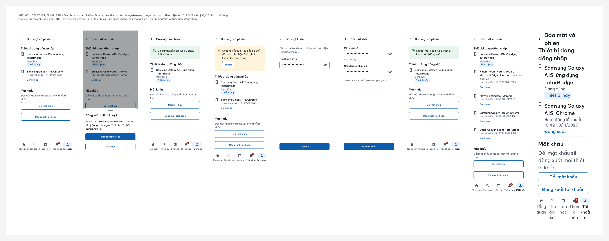

# AUTH06 Bảo mật và quản lý phiên

- **Trạng thái thiết kế:** Đã duyệt v1 (Đính, 10/11/2026); khung TBD chưa duyệt
- **Version Figma:** `Lát 1 v1 2026-11-10` (named version lưu tay trong Figma)
- **Node:** section [12:1287](https://www.figma.com/design/uuEo9SH3LxWcFbbHHFFBgl?node-id=12-1287)
- **Kênh:** Android
- **Route (đề xuất, Issue giao diện được chỉnh nếu xung đột router):** `/parent/account/security`, `/tutor/account/security`
- **Issue giao diện:** TB-10
- **Căn cứ:** UC01; FR-02, FR-39; đặc tả ở [06-man-hinh-lat-1.md](../06-man-hinh-lat-1.md)
- **API:** `listOwnSessions`, `revokeOwnSession`, `reauthenticate`, `changePassword`, `logoutAccount`

## Ảnh

Ảnh gồm mọi frame trạng thái của section theo thứ tự trong bảng dưới. Xem từng frame ở độ phân giải đầy đủ qua link node.

## Trạng thái

| Frame | Node |
|---|---|
| Bảo mật và phiên / Danh sách | [12:693](https://www.figma.com/design/uuEo9SH3LxWcFbbHHFFBgl?node-id=12-693) |
| Bảo mật và phiên / Xác nhận đăng xuất thiết bị | [12:761](https://www.figma.com/design/uuEo9SH3LxWcFbbHHFFBgl?node-id=12-761) |
| Bảo mật và phiên / Đã đăng xuất thiết bị | [12:835](https://www.figma.com/design/uuEo9SH3LxWcFbbHHFFBgl?node-id=12-835) |
| Bảo mật và phiên / Chưa rõ kết quả | [12:899](https://www.figma.com/design/uuEo9SH3LxWcFbbHHFFBgl?node-id=12-899) |
| Bảo mật và phiên / Xác thực lại | [12:969](https://www.figma.com/design/uuEo9SH3LxWcFbbHHFFBgl?node-id=12-969) |
| Bảo mật và phiên / Đổi mật khẩu | [12:992](https://www.figma.com/design/uuEo9SH3LxWcFbbHHFFBgl?node-id=12-992) |
| Bảo mật và phiên / Đã đổi mật khẩu | [12:1022](https://www.figma.com/design/uuEo9SH3LxWcFbbHHFFBgl?node-id=12-1022) |
| Bảo mật và phiên / Dữ liệu xấu nhất | [12:1084](https://www.figma.com/design/uuEo9SH3LxWcFbbHHFFBgl?node-id=12-1084) |
| Bảo mật và phiên / Chữ 200% | [12:1171](https://www.figma.com/design/uuEo9SH3LxWcFbbHHFFBgl?node-id=12-1171) |

Trạng thái chung (tải, lỗi tải, mất quyền, hết phiên, đang gửi, chưa rõ kết quả) theo [04-trang-thai-cau-chu.md](../04-trang-thai-cau-chu.md) khi frame không vẽ riêng.

## Câu chữ

Nguyên văn trong Figma; câu chung lấy từ [04](../04-trang-thai-cau-chu.md). `{…}` là dữ liệu thật thay vào.

| Vị trí | Chuỗi |
|---|---|
| Tiêu đề | Bảo mật và phiên |
| Mục | Thiết bị đang đăng nhập / Mật khẩu |
| Nhãn | Thiết bị này; hành động "Đăng xuất" dưới tên thiết bị |
| Bảng xác nhận | Đăng xuất thiết bị này? Phiên trên "{thiết bị}" sẽ bị đăng xuất ngay. Thiết bị đó phải đăng nhập lại. Nút: Đăng xuất thiết bị / Quay lại |
| Đã đăng xuất | Đã đăng xuất {thiết bị}. |
| Đổi mật khẩu | Để bảo vệ tài khoản, nhập mật khẩu hiện tại trước khi đổi. / Sau khi đổi, mọi thiết bị khác sẽ bị đăng xuất. / Đã đổi mật khẩu. Các thiết bị khác đã bị đăng xuất. |
| Nút cuối | Đổi mật khẩu / Đăng xuất tài khoản |

## Hành vi

- Hành động của mỗi dòng thiết bị đặt dưới tên thiết bị ở mọi cỡ chữ.
- Chỉ báo đã đăng xuất sau khi máy chủ xác nhận.

## Ánh xạ sang code

| Figma | Mobile |
|---|---|
| `TopAppBar` | Chưa có trong code, thêm ở Issue giao diện đầu tiên dùng nó (`shared/ui`) |
| `Button` | `Button.tsx` (variant, busy, disabled) |
| `ConfirmSheet` | Chưa có trong code, thêm ở Issue giao diện đầu tiên dùng nó (`shared/ui`) |
| `TextField` | `TextField.tsx`, `FormTextField` |
| `Notice` | `Notice.tsx` |
| `NavigationBar` | Chưa có trong code, thêm ở Issue giao diện đầu tiên dùng nó (`shared/ui`) |

## Khác so với đặc tả và câu hỏi còn mở

- TBD: `listOwnSessions` có trả tên thiết bị và trình duyệt không; nếu không, hiện "Thiết bị Android" và thời điểm đăng nhập.
- TBD: OP-22: nhãn thanh điều hướng ở chữ 200%.
