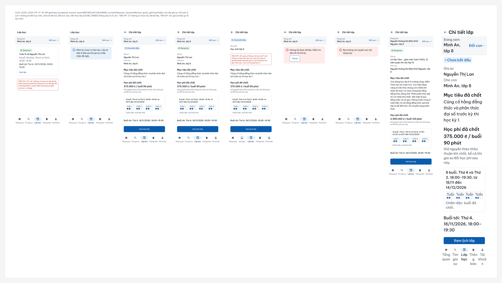

# CL01 Lớp học và thỏa thuận (chỉ xem)

- **Trạng thái thiết kế:** Đã duyệt v1 (Đính, 10/11/2026); khung TBD chưa duyệt
- **Version Figma:** `Lát 1 v1 2026-11-10` (named version lưu tay trong Figma)
- **Node:** section [36:5492](https://www.figma.com/design/uuEo9SH3LxWcFbbHHFFBgl?node-id=36-5492)
- **Kênh:** Android
- **Route (đề xuất, Issue giao diện được chỉnh nếu xung đột router):** `/parent/classes`, `/parent/classes/[classId]`, `/tutor/classes/[classId]`
- **Issue giao diện:** #73
- **Căn cứ:** UC04, UC07; FR-17–19; đặc tả ở [06-man-hinh-lat-1.md](../06-man-hinh-lat-1.md)
- **API:** `getClass`, `getTutorPublic`

## Ảnh

Ảnh gồm mọi frame trạng thái của section theo thứ tự trong bảng dưới. Xem từng frame ở độ phân giải đầy đủ qua link node.

## Trạng thái

| Frame | Node |
|---|---|
| Lớp học / Danh sách lớp của con | [36:4729](https://www.figma.com/design/uuEo9SH3LxWcFbbHHFFBgl?node-id=36-4729) |
| Lớp học / Chưa có lớp | [36:4790](https://www.figma.com/design/uuEo9SH3LxWcFbbHHFFBgl?node-id=36-4790) |
| Chi tiết lớp / Phụ huynh, chưa bắt đầu | [36:4841](https://www.figma.com/design/uuEo9SH3LxWcFbbHHFFBgl?node-id=36-4841) |
| Chi tiết lớp / Phụ huynh, đang học | [36:4933](https://www.figma.com/design/uuEo9SH3LxWcFbbHHFFBgl?node-id=36-4933) |
| Chi tiết lớp / Gia sư | [36:5025](https://www.figma.com/design/uuEo9SH3LxWcFbbHHFFBgl?node-id=36-5025) |
| Chi tiết lớp / Lỗi tải | [36:5109](https://www.figma.com/design/uuEo9SH3LxWcFbbHHFFBgl?node-id=36-5109) |
| Chi tiết lớp / Mất quyền | [36:5162](https://www.figma.com/design/uuEo9SH3LxWcFbbHHFFBgl?node-id=36-5162) |
| Chi tiết lớp / Dữ liệu xấu nhất | [36:5215](https://www.figma.com/design/uuEo9SH3LxWcFbbHHFFBgl?node-id=36-5215) |
| Chi tiết lớp / Chữ 200% | [36:5307](https://www.figma.com/design/uuEo9SH3LxWcFbbHHFFBgl?node-id=36-5307) |

Trạng thái chung (tải, lỗi tải, mất quyền, hết phiên, đang gửi, chưa rõ kết quả) theo [04-trang-thai-cau-chu.md](../04-trang-thai-cau-chu.md) khi frame không vẽ riêng.

## Câu chữ

Nguyên văn trong Figma; câu chung lấy từ [04](../04-trang-thai-cau-chu.md). `{…}` là dữ liệu thật thay vào.

| Vị trí | Chuỗi |
|---|---|
| Nhãn | Chưa bắt đầu / Đang học |
| Mục | Gia sư / Cho con / Mục tiêu đã chốt / Học phí đã chốt |
| Học phí | Giữ nguyên theo thỏa thuận khi chốt, kể cả khi gia sư đổi học phí sau này. |
| Buổi tới | Buổi tới: Thứ 4, 18/11/2026, 18:00–19:30 |
| Rỗng | {con} chưa có lớp nào. Lớp sẽ hiện ở đây sau khi gia sư chấp nhận đề nghị. |
| Nút | Xem lịch lớp |

## Hành vi

- Không có đổi mục tiêu, chia sẻ liên hệ, đổi lịch, hủy, kết thúc lớp (UC08).

## Ánh xạ sang code

| Figma | Mobile |
|---|---|
| `TopAppBar` | Chưa có trong code, thêm ở Issue giao diện đầu tiên dùng nó (`shared/ui`) |
| `StudentSwitcher` | Chưa có trong code, thêm ở Issue giao diện đầu tiên dùng nó (`shared/ui`) |
| `StatusLabel` | Chưa có trong code, thêm ở Issue giao diện đầu tiên dùng nó (`shared/ui`) |
| `PriceBlock` | Chưa có trong code, thêm ở Issue giao diện đầu tiên dùng nó (`shared/ui`) |
| `CycleStrip` | Chưa có trong code, thêm ở Issue giao diện đầu tiên dùng nó (`shared/ui`) |
| `StickyActionBar` | Chưa có trong code, thêm ở Issue giao diện đầu tiên dùng nó (`shared/ui`) |
| `Notice` | `Notice.tsx` |
| `NavigationBar` | Chưa có trong code, thêm ở Issue giao diện đầu tiên dùng nó (`shared/ui`) |

## Khác so với đặc tả và câu hỏi còn mở

- OP-27 đã có `listClasses` (#97, #258, #271). Màn danh sách lớp làm ở #73 PR 3.
- OP-25 đã chốt 12/11/2026: gia sư chỉ thấy tên hiển thị của học sinh sau khi chốt lớp; đề nghị đang chờ không hiện tên. `Class.studentDisplayName` có từ #258. Frame "Gia sư" ghi "Học sinh lớp 8"; code hiện "Học sinh" và tên con, không có khối lớp vì `Class` không trả khối.
- Code #73 PR 2 (chi tiết lớp) khác Figma v1 (28/11/2026):
  - TBD (hỏi Đính): `PriceBlock` của `03-thanh-phan.md` đòi đủ giá 60 phút, thời lượng, giá buổi, nhưng `Class` không có giá 60 phút. Code làm đúng frame CL01: "{giá buổi} / buổi {thời lượng} phút" và câu giữ nguyên học phí; không tự tính giá 60 phút (BR02).
  - Dòng chu kỳ khi các thứ có giờ khác nhau ghi giờ theo từng thứ, ví dụ "3 buổi, Thứ 2 17:00–18:30, Thứ 4 18:00–19:30 và Thứ 6 18:00–19:30, từ 16/11 đến 20/11/2026". Frame chỉ vẽ một giờ chung.
  - `CycleStrip` của lớp: chấm đặc là buổi đã chốt, chấm xám là buổi đã qua, vòng rỗng là buổi đã hủy (`03`: đã qua, đã hủy khác hình dấu). Chú thích giữ đúng "Chấm đặc: buổi đã chốt.".
  - "Buổi tới" là buổi `SCHEDULED` sớm nhất chưa kết thúc, như `nextSession` của `listClasses`; hết buổi thì không hiện dòng này.
  - Lỗi đọc tên gia sư không chặn màn, chỉ bỏ dòng "Gia sư" (như CL02).
  - `ENDED` không xảy ra ở Lát 1 nên không có nhãn.
  - Chọn con khác thì lưu lựa chọn và rời màn, như CL02 (Đính chốt khi rà #260, 28/11/2026).
