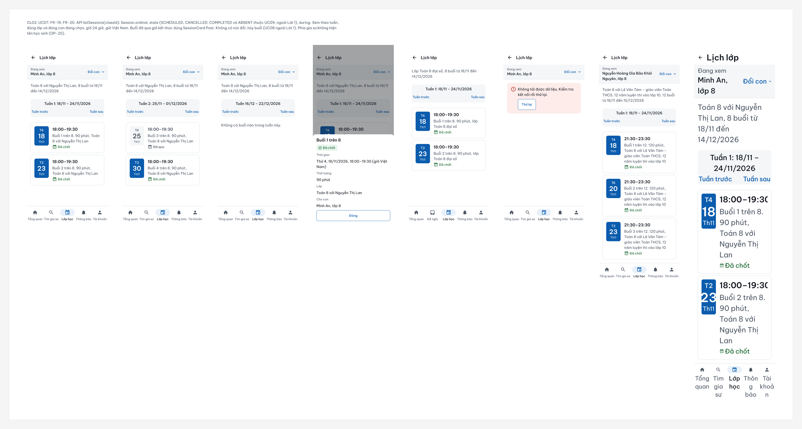

# CL02 Lịch lớp và chi tiết buổi (chỉ xem)

- **Trạng thái thiết kế:** Đã duyệt v1 (Đính, 10/11/2026); khung TBD chưa duyệt
- **Version Figma:** `Lát 1 v1 2026-11-10` (named version lưu tay trong Figma)
- **Node:** section [37:5838](https://www.figma.com/design/uuEo9SH3LxWcFbbHHFFBgl?node-id=37-5838)
- **Kênh:** Android
- **Route (đề xuất, Issue giao diện được chỉnh nếu xung đột router):** `/parent/classes/[classId]/sessions`, `/tutor/classes/[classId]/sessions`
- **Issue giao diện:** #73
- **Căn cứ:** UC07; FR-19, FR-20; đặc tả ở [06-man-hinh-lat-1.md](../06-man-hinh-lat-1.md)
- **API:** `listSessions`

## Ảnh

Ảnh gồm mọi frame trạng thái của section theo thứ tự trong bảng dưới. Xem từng frame ở độ phân giải đầy đủ qua link node.

## Trạng thái

| Frame | Node |
|---|---|
| Lịch lớp / Tuần có buổi | [37:5156](https://www.figma.com/design/uuEo9SH3LxWcFbbHHFFBgl?node-id=37-5156) |
| Lịch lớp / Có buổi đã qua | [37:5234](https://www.figma.com/design/uuEo9SH3LxWcFbbHHFFBgl?node-id=37-5234) |
| Lịch lớp / Tuần không có buổi | [37:5313](https://www.figma.com/design/uuEo9SH3LxWcFbbHHFFBgl?node-id=37-5313) |
| Lịch lớp / Chi tiết buổi | [37:5368](https://www.figma.com/design/uuEo9SH3LxWcFbbHHFFBgl?node-id=37-5368) |
| Lịch lớp / Gia sư | [37:5464](https://www.figma.com/design/uuEo9SH3LxWcFbbHHFFBgl?node-id=37-5464) |
| Lịch lớp / Lỗi tải | [37:5534](https://www.figma.com/design/uuEo9SH3LxWcFbbHHFFBgl?node-id=37-5534) |
| Lịch lớp / Dữ liệu xấu nhất | [37:5587](https://www.figma.com/design/uuEo9SH3LxWcFbbHHFFBgl?node-id=37-5587) |
| Lịch lớp / Chữ 200% | [37:5846](https://www.figma.com/design/uuEo9SH3LxWcFbbHHFFBgl?node-id=37-5846) |

Trạng thái chung (tải, lỗi tải, mất quyền, hết phiên, đang gửi, chưa rõ kết quả) theo [04-trang-thai-cau-chu.md](../04-trang-thai-cau-chu.md) khi frame không vẽ riêng.

## Câu chữ

Nguyên văn trong Figma; câu chung lấy từ [04](../04-trang-thai-cau-chu.md). `{…}` là dữ liệu thật thay vào.

| Vị trí | Chuỗi |
|---|---|
| Thanh tuần | Tuần 1: 18/11 – 24/11/2026 / Tuần trước / Tuần sau |
| Thẻ | Buổi 1 trên 8. 90 phút, Toán 8 với {gia sư} |
| Rỗng | Không có buổi nào trong tuần này. |
| Chi tiết buổi | Buổi 1 trên 8 / Đã chốt / Thời gian: Thứ 4, 18/11/2026, 18:00–19:30 (giờ Việt Nam) / Thời lượng / Lớp / Cho con. Nút: Đóng |

## Hành vi

- Thanh tuần: nhãn ở trên, hai nút ở hàng dưới.
- Buổi đã qua giờ kết thúc dùng SessionCard Past.

## Ánh xạ sang code

| Figma | Mobile |
|---|---|
| `TopAppBar` | Chưa có trong code, thêm ở Issue giao diện đầu tiên dùng nó (`shared/ui`) |
| `StudentSwitcher` | Chưa có trong code, thêm ở Issue giao diện đầu tiên dùng nó (`shared/ui`) |
| `SessionCard` | Chưa có trong code, thêm ở Issue giao diện đầu tiên dùng nó (`shared/ui`) |
| `StatusLabel` | Chưa có trong code, thêm ở Issue giao diện đầu tiên dùng nó (`shared/ui`) |
| `Button` | `Button.tsx` (variant, busy, disabled) |
| `NavigationBar` | Chưa có trong code, thêm ở Issue giao diện đầu tiên dùng nó (`shared/ui`) |

## Khác so với đặc tả và câu hỏi còn mở

- OP-25 đã chốt 12/11/2026: gia sư chỉ thấy tên hiển thị của học sinh sau khi chốt lớp; đề nghị đang chờ không hiện tên. Chờ trường mới trong hợp đồng lớp (#97).
- Bảng chọn con trên CL02 phía phụ huynh (Đính chốt khi rà #260, 28/11/2026):
  - Chọn con khác thì lưu lựa chọn và quay về màn trước, vì lớp thuộc một con. Không có màn trước thì về trang chủ phụ huynh. TBD: về danh sách lớp của con đó khi có `listClasses` (#97).
  - "Quản lý hồ sơ các con" mở PH02 (`/parent/account/students`), không quay về.
