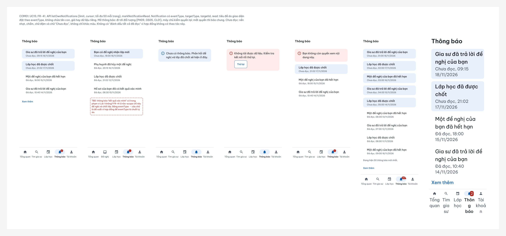

# COM01 Hộp thông báo

- **Trạng thái thiết kế:** Đã duyệt v1 (Đính, 10/11/2026); khung TBD chưa duyệt
- **Version Figma:** `Lát 1 v1 2026-11-10` (named version lưu tay trong Figma)
- **Node:** section [38:475](https://www.figma.com/design/uuEo9SH3LxWcFbbHHFFBgl?node-id=38-475)
- **Kênh:** Android
- **Route (đề xuất, Issue giao diện được chỉnh nếu xung đột router):** `/parent/notifications`, `/tutor/notifications`
- **Issue giao diện:** #74
- **Căn cứ:** UC15; FR-41; đặc tả ở [06-man-hinh-lat-1.md](../06-man-hinh-lat-1.md)
- **API:** `listOwnNotifications`, `markNotificationRead`

## Ảnh

Ảnh gồm mọi frame trạng thái của section theo thứ tự trong bảng dưới. Xem từng frame ở độ phân giải đầy đủ qua link node.

## Trạng thái

| Frame | Node |
|---|---|
| Thông báo / Phụ huynh | [38:2](https://www.figma.com/design/uuEo9SH3LxWcFbbHHFFBgl?node-id=38-2) |
| Thông báo / Gia sư | [38:68](https://www.figma.com/design/uuEo9SH3LxWcFbbHHFFBgl?node-id=38-68) |
| Thông báo / Rỗng | [38:134](https://www.figma.com/design/uuEo9SH3LxWcFbbHHFFBgl?node-id=38-134) |
| Thông báo / Lỗi tải | [38:178](https://www.figma.com/design/uuEo9SH3LxWcFbbHHFFBgl?node-id=38-178) |
| Thông báo / Mở mục không còn quyền | [38:222](https://www.figma.com/design/uuEo9SH3LxWcFbbHHFFBgl?node-id=38-222) |
| Thông báo / Dữ liệu xấu nhất | [38:282](https://www.figma.com/design/uuEo9SH3LxWcFbbHHFFBgl?node-id=38-282) |
| Thông báo / Chữ 200% | [38:374](https://www.figma.com/design/uuEo9SH3LxWcFbbHHFFBgl?node-id=38-374) |

Trạng thái chung (tải, lỗi tải, mất quyền, hết phiên, đang gửi, chưa rõ kết quả) theo [04-trang-thai-cau-chu.md](../04-trang-thai-cau-chu.md) khi frame không vẽ riêng.

## Câu chữ

Nguyên văn trong Figma; câu chung lấy từ [04](../04-trang-thai-cau-chu.md). `{…}` là dữ liệu thật thay vào.

| Vị trí | Chuỗi |
|---|---|
| Phụ huynh | Gia sư đã trả lời đề nghị của bạn / Lớp học đã được chốt / Một đề nghị của bạn đã hết hạn |
| Gia sư | Bạn có đề nghị nhận lớp mới / Phụ huynh đã hủy một đề nghị / Lớp học đã được chốt |
| Dòng phụ | Chưa đọc, 09:15 18/11/2026 / Đã đọc, … |
| Rỗng | Chưa có thông báo. Phản hồi đề nghị và lớp đã chốt sẽ hiện ở đây. |
| Mất quyền | Bạn không còn quyền xem nội dung này. |

## Hành vi

- Mở thông báo: đánh dấu đã đọc và đi tới PH09, GS05 hoặc CL01; máy chủ kiểm quyền lại.
- Không có "đánh dấu tất cả đã đọc".

## Ánh xạ sang code

| Figma | Mobile |
|---|---|
| `TopAppBar` | Chưa có trong code, thêm ở Issue giao diện đầu tiên dùng nó (`shared/ui`) |
| `Notice` | `Notice.tsx` |
| `NavigationBar` | `NavigationBar.tsx` (#95 phần 1b); tab theo vai trò gắn ở Issue màn hình |

## Khác so với đặc tả và câu hỏi còn mở

- TBD: eventType là chuỗi tự do: bảng eventType sang câu chữ là đề xuất.
- TBD: Thông báo "kết quả xác minh" có trong Lát 1 không.
