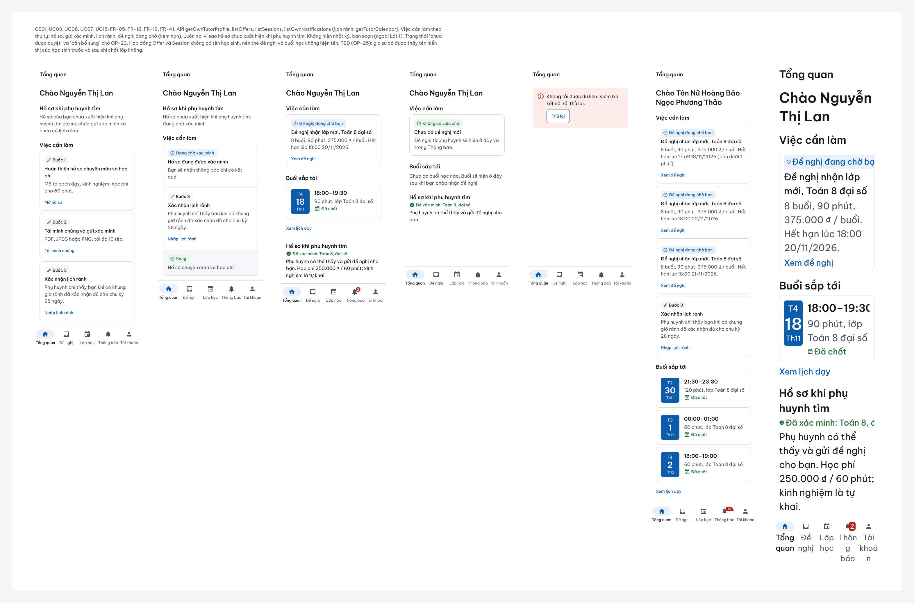

# GS01 Trang chủ gia sư

- **Trạng thái thiết kế:** Đã duyệt v1 (Đính, 10/11/2026); khung TBD chưa duyệt
- **Version Figma:** `Lát 1 v1 2026-11-10` (named version lưu tay trong Figma)
- **Node:** section [23:1043](https://www.figma.com/design/uuEo9SH3LxWcFbbHHFFBgl?node-id=23-1043)
- **Kênh:** Android
- **Route (đề xuất, Issue giao diện được chỉnh nếu xung đột router):** `/tutor`
- **Issue giao diện:** TB-14
- **Căn cứ:** UC03, UC06, UC07, UC15; FR-05, FR-16, FR-19, FR-41; đặc tả ở [06-man-hinh-lat-1.md](../06-man-hinh-lat-1.md)
- **API:** `getOwnTutorProfile`, `listOffers`, `listSessions`, `listOwnNotifications`, `getTutorCalendar`

## Ảnh

Ảnh gồm mọi frame trạng thái của section theo thứ tự trong bảng dưới. Xem từng frame ở độ phân giải đầy đủ qua link node.

## Trạng thái

| Frame | Node |
|---|---|
| Trang chủ gia sư / Mới đăng ký | [23:475](https://www.figma.com/design/uuEo9SH3LxWcFbbHHFFBgl?node-id=23-475) |
| Trang chủ gia sư / Đang chờ xác minh | [23:551](https://www.figma.com/design/uuEo9SH3LxWcFbbHHFFBgl?node-id=23-551) |
| Trang chủ gia sư / Đang nhận lớp | [23:618](https://www.figma.com/design/uuEo9SH3LxWcFbbHHFFBgl?node-id=23-618) |
| Trang chủ gia sư / Chưa có lớp | [23:690](https://www.figma.com/design/uuEo9SH3LxWcFbbHHFFBgl?node-id=23-690) |
| Trang chủ gia sư / Lỗi tải | [23:746](https://www.figma.com/design/uuEo9SH3LxWcFbbHHFFBgl?node-id=23-746) |
| Trang chủ gia sư / Dữ liệu xấu nhất | [23:788](https://www.figma.com/design/uuEo9SH3LxWcFbbHHFFBgl?node-id=23-788) |
| Trang chủ gia sư / Chữ 200% | [23:906](https://www.figma.com/design/uuEo9SH3LxWcFbbHHFFBgl?node-id=23-906) |

Trạng thái chung (tải, lỗi tải, mất quyền, hết phiên, đang gửi, chưa rõ kết quả) theo [04-trang-thai-cau-chu.md](../04-trang-thai-cau-chu.md) khi frame không vẽ riêng.

## Câu chữ

Nguyên văn trong Figma; câu chung lấy từ [04](../04-trang-thai-cau-chu.md). `{…}` là dữ liệu thật thay vào.

| Vị trí | Chuỗi |
|---|---|
| Khối | Việc cần làm / Buổi sắp tới / Hồ sơ khi phụ huynh tìm |
| Bước | Bước 1: Hoàn thiện hồ sơ chuyên môn và học phí / Bước 2: Tải minh chứng và gửi xác minh / Bước 3: Xác nhận lịch rảnh |
| Hiển thị | Hồ sơ của bạn chưa xuất hiện khi phụ huynh tìm gia sư: chưa gửi xác minh và chưa có lịch rảnh. / Phụ huynh có thể thấy và gửi đề nghị cho bạn. |
| Đề nghị | Đề nghị nhận lớp mới, Toán 8 đại số. 8 buổi, 90 phút, 375.000 ₫ / buổi. Hết hạn lúc 18:00 20/11/2026. Nút: Xem đề nghị |

## Hành vi

- Không hiện nhật ký, bản soạn (ngoài Lát 1).

## Ánh xạ sang code

| Figma | Mobile |
|---|---|
| `TopAppBar` | Chưa có trong code, thêm ở Issue giao diện đầu tiên dùng nó (`shared/ui`) |
| `StatusLabel` | Chưa có trong code, thêm ở Issue giao diện đầu tiên dùng nó (`shared/ui`) |
| `VerificationLabel` | Chưa có trong code, thêm ở Issue giao diện đầu tiên dùng nó (`shared/ui`) |
| `SessionCard` | Chưa có trong code, thêm ở Issue giao diện đầu tiên dùng nó (`shared/ui`) |
| `Notice` | `Notice.tsx` |
| `NavigationBar` | Chưa có trong code, thêm ở Issue giao diện đầu tiên dùng nó (`shared/ui`) |

## Khác so với đặc tả và câu hỏi còn mở

- OP-25 đã chốt 12/11/2026: gia sư chỉ thấy tên hiển thị của học sinh sau khi chốt lớp; đề nghị đang chờ không hiện tên. Chờ trường mới trong hợp đồng lớp (#97).
- TBD: OP-27: buổi sắp tới cần classId.
- TBD: OP-23: trạng thái chưa được duyệt, cần bổ sung.
