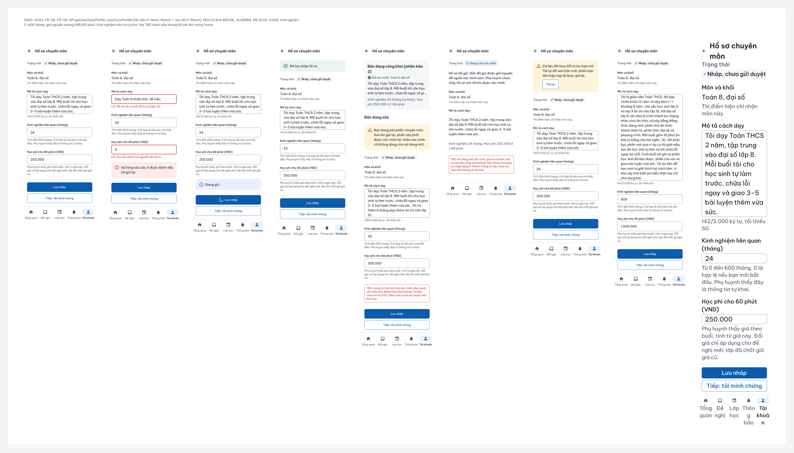

# GS02 Hồ sơ chuyên môn và học phí

- **Trạng thái thiết kế:** Đã duyệt v1 (Đính, 10/11/2026); khung TBD chưa duyệt
- **Version Figma:** `Lát 1 v1 2026-11-10` (named version lưu tay trong Figma)
- **Node:** section [16:1925](https://www.figma.com/design/uuEo9SH3LxWcFbbHHFFBgl?node-id=16-1925)
- **Kênh:** Android
- **Route (đề xuất, Issue giao diện được chỉnh nếu xung đột router):** `/tutor/account/profile`
- **Issue giao diện:** TB-14
- **Căn cứ:** UC03; FR-05, FR-06; đặc tả ở [06-man-hinh-lat-1.md](../06-man-hinh-lat-1.md)
- **API:** `getOwnTutorProfile`, `saveTutorProfile`

## Ảnh

Ảnh gồm mọi frame trạng thái của section theo thứ tự trong bảng dưới. Xem từng frame ở độ phân giải đầy đủ qua link node.

## Trạng thái

| Frame | Node |
|---|---|
| Hồ sơ chuyên môn / Nháp | [16:1108](https://www.figma.com/design/uuEo9SH3LxWcFbbHHFFBgl?node-id=16-1108) |
| Hồ sơ chuyên môn / Lỗi trường | [16:1191](https://www.figma.com/design/uuEo9SH3LxWcFbbHHFFBgl?node-id=16-1191) |
| Hồ sơ chuyên môn / Đang gửi | [16:1276](https://www.figma.com/design/uuEo9SH3LxWcFbbHHFFBgl?node-id=16-1276) |
| Hồ sơ chuyên môn / Đã lưu nháp | [16:1364](https://www.figma.com/design/uuEo9SH3LxWcFbbHHFFBgl?node-id=16-1364) |
| Hồ sơ chuyên môn / Đã duyệt, đang sửa | [16:1449](https://www.figma.com/design/uuEo9SH3LxWcFbbHHFFBgl?node-id=16-1449) |
| Hồ sơ chuyên môn / Đang chờ xác minh | [16:1545](https://www.figma.com/design/uuEo9SH3LxWcFbbHHFFBgl?node-id=16-1545) |
| Hồ sơ chuyên môn / Bản cũ | [16:1600](https://www.figma.com/design/uuEo9SH3LxWcFbbHHFFBgl?node-id=16-1600) |
| Hồ sơ chuyên môn / Dữ liệu xấu nhất | [16:1684](https://www.figma.com/design/uuEo9SH3LxWcFbbHHFFBgl?node-id=16-1684) |
| Hồ sơ chuyên môn / Chữ 200% | [16:1761](https://www.figma.com/design/uuEo9SH3LxWcFbbHHFFBgl?node-id=16-1761) |

Trạng thái chung (tải, lỗi tải, mất quyền, hết phiên, đang gửi, chưa rõ kết quả) theo [04-trang-thai-cau-chu.md](../04-trang-thai-cau-chu.md) khi frame không vẽ riêng.

## Câu chữ

Nguyên văn trong Figma; câu chung lấy từ [04](../04-trang-thai-cau-chu.md). `{…}` là dữ liệu thật thay vào.

| Vị trí | Chuỗi |
|---|---|
| Môn | Toán 8, đại số. Thí điểm hiện chỉ nhận môn này. |
| Ô | Mô tả cách dạy (…/3.000 ký tự, tối thiểu 50.) / Kinh nghiệm liên quan (tháng) (Từ 0 đến 600 tháng. 0 là hợp lệ nếu bạn mới bắt đầu. Phụ huynh thấy đây là thông tin tự khai.) / Học phí cho 60 phút (VND) (Phụ huynh thấy giá theo buổi, tính từ giá này. Đổi giá chỉ áp dụng cho đề nghị mới; lớp đã chốt giữ giá cũ.) |
| Đang sửa | Bạn đang sửa phần chuyên môn. Sau khi gửi lại, phần này phải được xác minh lại; nhãn xác minh cũ không dùng cho nội dung mới. |
| Lỗi | Lỗi: Mô tả cần ít nhất 50 ký tự (hiện 31). / Lỗi: Học phí phải là số nguyên lớn hơn 0. |
| Nút | Lưu nháp / Tiếp: tải minh chứng |

## Hành vi

- Lần đầu lưu dùng If-None-Match: *, sau đó If-Match.
- OP-24 (Đính chốt 12/11/2026): bản sửa đang chờ xác minh thì phụ huynh vẫn thấy bản đã duyệt hiện hành cùng nhãn của chính bản đó. Đang chờ thì khóa, không sửa tiếp (frame "Đang chờ xác minh"). Cần bổ sung hoặc bị từ chối thì được sửa và gửi lại thành phiên bản mới.

## Ánh xạ sang code

| Figma | Mobile |
|---|---|
| `TopAppBar` | Chưa có trong code, thêm ở Issue giao diện đầu tiên dùng nó (`shared/ui`) |
| `StatusLabel` | Chưa có trong code, thêm ở Issue giao diện đầu tiên dùng nó (`shared/ui`) |
| `VerificationLabel` | Chưa có trong code, thêm ở Issue giao diện đầu tiên dùng nó (`shared/ui`) |
| `TextField` | `TextField.tsx`, `FormTextField` |
| `StickyActionBar` | Chưa có trong code, thêm ở Issue giao diện đầu tiên dùng nó (`shared/ui`) |
| `Notice` | `Notice.tsx` |
| `NavigationBar` | Chưa có trong code, thêm ở Issue giao diện đầu tiên dùng nó (`shared/ui`) |

## Khác so với đặc tả và câu hỏi còn mở

- OP-24 đã chốt 12/11/2026, xem "Hành vi". Câu chữ cho "Cần bổ sung" và "Bị từ chối, sửa để gửi lại" chưa có frame: vẽ cùng GS03 v2 sau khi #96 merge.
