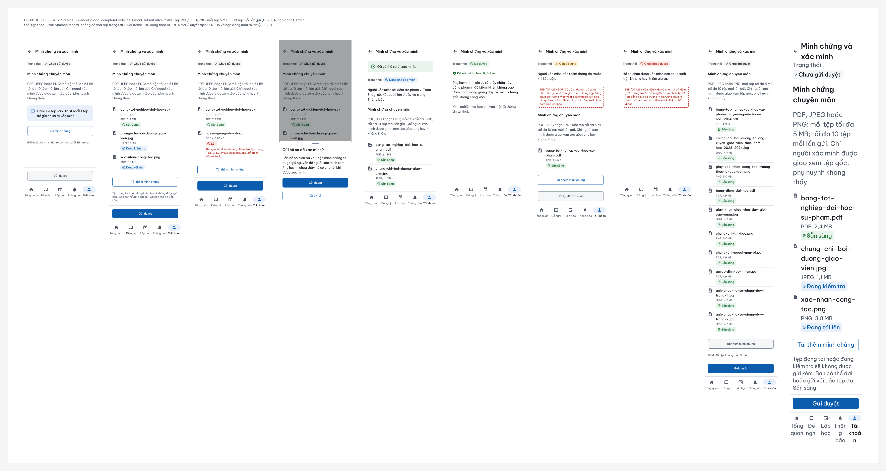

# GS03 Minh chứng và kết quả xác minh

- **Trạng thái thiết kế:** Đã duyệt v1 (Đính, 10/11/2026); khung TBD chưa duyệt
- **Version Figma:** `Lát 1 v1 2026-11-10` (named version lưu tay trong Figma)
- **Node:** section [17:2447](https://www.figma.com/design/uuEo9SH3LxWcFbbHHFFBgl?node-id=17-2447)
- **Kênh:** Android
- **Route (đề xuất, Issue giao diện được chỉnh nếu xung đột router):** `/tutor/account/evidence`
- **Issue giao diện:** TB-14
- **Căn cứ:** UC03; FR-07; đặc tả ở [06-man-hinh-lat-1.md](../06-man-hinh-lat-1.md)
- **API:** `createEvidenceUpload`, `completeEvidenceUpload`, `submitTutorProfile`

## Ảnh

Ảnh gồm mọi frame trạng thái của section theo thứ tự trong bảng dưới. Xem từng frame ở độ phân giải đầy đủ qua link node.

## Trạng thái

| Frame | Node |
|---|---|
| Minh chứng / Chưa có tệp | [17:1543](https://www.figma.com/design/uuEo9SH3LxWcFbbHHFFBgl?node-id=17-1543) |
| Minh chứng / Đang tải và kiểm tra | [17:1604](https://www.figma.com/design/uuEo9SH3LxWcFbbHHFFBgl?node-id=17-1604) |
| Minh chứng / Tệp lỗi | [17:1700](https://www.figma.com/design/uuEo9SH3LxWcFbbHHFFBgl?node-id=17-1700) |
| Minh chứng / Xác nhận gửi duyệt | [17:1778](https://www.figma.com/design/uuEo9SH3LxWcFbbHHFFBgl?node-id=17-1778) |
| Minh chứng / Đang chờ xác minh | [17:1859](https://www.figma.com/design/uuEo9SH3LxWcFbbHHFFBgl?node-id=17-1859) |
| Minh chứng / Đã xác minh | [17:1935](https://www.figma.com/design/uuEo9SH3LxWcFbbHHFFBgl?node-id=17-1935) |
| Minh chứng / Cần bổ sung (TBD) | [17:1985](https://www.figma.com/design/uuEo9SH3LxWcFbbHHFFBgl?node-id=17-1985) |
| Minh chứng / Chưa được duyệt (TBD) | [17:2052](https://www.figma.com/design/uuEo9SH3LxWcFbbHHFFBgl?node-id=17-2052) |
| Minh chứng / Dữ liệu xấu nhất | [17:2099](https://www.figma.com/design/uuEo9SH3LxWcFbbHHFFBgl?node-id=17-2099) |
| Minh chứng / Chữ 200% | [17:2252](https://www.figma.com/design/uuEo9SH3LxWcFbbHHFFBgl?node-id=17-2252) |

Trạng thái chung (tải, lỗi tải, mất quyền, hết phiên, đang gửi, chưa rõ kết quả) theo [04-trang-thai-cau-chu.md](../04-trang-thai-cau-chu.md) khi frame không vẽ riêng.

## Câu chữ

Nguyên văn trong Figma; câu chung lấy từ [04](../04-trang-thai-cau-chu.md). `{…}` là dữ liệu thật thay vào.

| Vị trí | Chuỗi |
|---|---|
| Quy tắc | PDF, JPEG hoặc PNG; mỗi tệp tối đa 5 MB; tối đa 10 tệp mỗi lần gửi. Chỉ người xác minh được giao xem tệp gốc; phụ huynh không thấy. |
| Trạng thái tệp | Đang tải lên / Đang kiểm tra / Sẵn sàng / Lỗi (Không nhận được tệp này. Kiểm tra định dạng (PDF, JPEG, PNG) và dung lượng (tối đa 5 MB) rồi tải lại.) |
| Bảng gửi | Gửi hồ sơ để xác minh? Bản hồ sơ hiện tại và 2 tệp minh chứng sẽ được giữ nguyên để người xác minh xem. Phụ huynh chưa thấy hồ sơ cho tới khi được xác minh. |
| Đã xác minh | Phụ huynh tìm gia sư sẽ thấy nhãn này cùng phạm vi đã kiểm. Nhãn không bảo đảm chất lượng giảng dạy, và minh chứng gốc không công khai. |
| Nút | Tải minh chứng / Tải thêm minh chứng / Gửi duyệt |

## Hành vi

- Gửi duyệt cần ít nhất 1 tệp Sẵn sàng.
- Không có xóa tệp (hợp đồng không có).

## Ánh xạ sang code

| Figma | Mobile |
|---|---|
| `TopAppBar` | `TopAppBar.tsx` qua `QueryScreen` |
| `StatusLabel` | `StatusLabel.tsx` |
| `VerificationLabel` | Chưa có trong code, thêm ở Issue giao diện đầu tiên dùng nó (`shared/ui`) |
| `FileRow` | `FileRow.tsx` (thêm ở TB-14, GS03) |
| `ConfirmSheet` | `ConfirmSheet.tsx` (thêm ở TB-14, GS03) |
| `StickyActionBar` | `StickyActionBar.tsx` |
| `Notice` | `Notice.tsx` |
| `NavigationBar` | `NavigationBar.tsx`; chưa gắn vào route, gắn ở #205 |

## Khác so với đặc tả và câu hỏi còn mở

- TBD: OP-23: "Cần bổ sung" và "Chưa được duyệt" cần lý do; hợp đồng chưa có.
- TB-14 (22/11/2026): màn hình dựng ở `features/tutor-evidence`, route vẫn là `ComingSoon` tới khi Đính trả lời Q12 (thư viện chọn tệp) trên #14. "Cần bổ sung" và "Chưa được duyệt" dùng câu chữ GS01 v2 kèm lý do (OP-23 đã chốt), chờ Đính ở Q9. Câu hỏi Q12–Q14 ở `docs/handoff/TB-14.md`.
