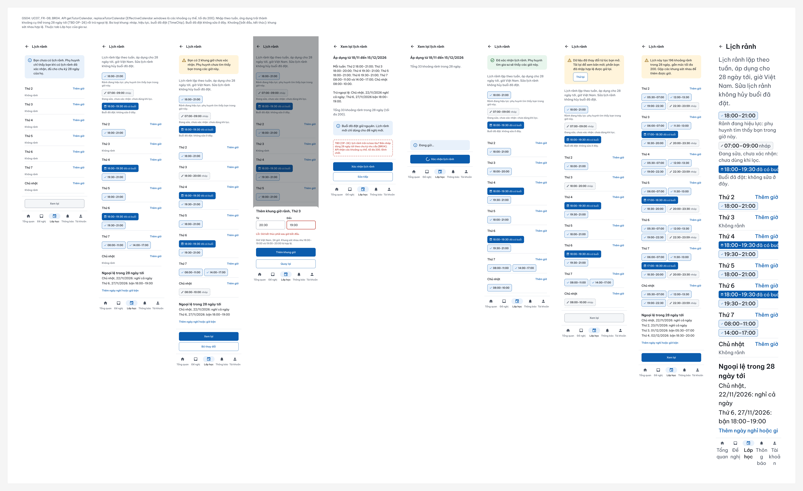

# GS04 Lịch rảnh và ngoại lệ

- **Trạng thái thiết kế:** Đã duyệt v1 (Đính, 10/11/2026); khung TBD chưa duyệt
- **Version Figma:** `Lát 1 v1 2026-11-10` (named version lưu tay trong Figma)
- **Node:** section [27:2228](https://www.figma.com/design/uuEo9SH3LxWcFbbHHFFBgl?node-id=27-2228)
- **Kênh:** Android
- **Route (đề xuất, Issue giao diện được chỉnh nếu xung đột router):** `/tutor/calendar`
- **Issue giao diện:** #69
- **Căn cứ:** UC07; FR-08; BR04; đặc tả ở [06-man-hinh-lat-1.md](../06-man-hinh-lat-1.md)
- **API:** `getTutorCalendar`, `replaceTutorCalendar`

## Ảnh

Ảnh gồm mọi frame trạng thái của section theo thứ tự trong bảng dưới. Xem từng frame ở độ phân giải đầy đủ qua link node.

## Trạng thái

| Frame | Node |
|---|---|
| Lịch rảnh / Chưa có lịch | [27:738](https://www.figma.com/design/uuEo9SH3LxWcFbbHHFFBgl?node-id=27-738) |
| Lịch rảnh / Đang hiệu lực | [27:838](https://www.figma.com/design/uuEo9SH3LxWcFbbHHFFBgl?node-id=27-838) |
| Lịch rảnh / Đang sửa, chưa xác nhận | [27:984](https://www.figma.com/design/uuEo9SH3LxWcFbbHHFFBgl?node-id=27-984) |
| Lịch rảnh / Thêm khung giờ (lỗi giờ) | [27:1151](https://www.figma.com/design/uuEo9SH3LxWcFbbHHFFBgl?node-id=27-1151) |
| Lịch rảnh / Xem lại | [27:1316](https://www.figma.com/design/uuEo9SH3LxWcFbbHHFFBgl?node-id=27-1316) |
| Lịch rảnh / Đang gửi | [27:1372](https://www.figma.com/design/uuEo9SH3LxWcFbbHHFFBgl?node-id=27-1372) |
| Lịch rảnh / Đã xác nhận | [27:1425](https://www.figma.com/design/uuEo9SH3LxWcFbbHHFFBgl?node-id=27-1425) |
| Lịch rảnh / Bản cũ | [27:1579](https://www.figma.com/design/uuEo9SH3LxWcFbbHHFFBgl?node-id=27-1579) |
| Lịch rảnh / Dữ liệu xấu nhất | [27:1737](https://www.figma.com/design/uuEo9SH3LxWcFbbHHFFBgl?node-id=27-1737) |
| Lịch rảnh / Chữ 200% | [27:2230](https://www.figma.com/design/uuEo9SH3LxWcFbbHHFFBgl?node-id=27-2230) |

Trạng thái chung (tải, lỗi tải, mất quyền, hết phiên, đang gửi, chưa rõ kết quả) theo [04-trang-thai-cau-chu.md](../04-trang-thai-cau-chu.md) khi frame không vẽ riêng.

## Câu chữ

Nguyên văn trong Figma; câu chung lấy từ [04](../04-trang-thai-cau-chu.md). `{…}` là dữ liệu thật thay vào.

| Vị trí | Chuỗi |
|---|---|
| Dẫn | Lịch rảnh lặp theo tuần, áp dụng cho 28 ngày tới, giờ Việt Nam. Sửa lịch rảnh không hủy buổi đã đặt. |
| Chú thích | Rảnh đang hiệu lực: phụ huynh tìm thấy bạn trong giờ này. / Đang sửa, chưa xác nhận: chưa dùng khi lọc. / Buổi đã đặt: không sửa ở đây. |
| Ngoại lệ | Ngoại lệ trong 28 ngày tới. Ví dụ: Chủ nhật, 22/11/2026: nghỉ cả ngày. Nút: Thêm ngày nghỉ hoặc giờ bận |
| Bảng thêm giờ | Thêm khung giờ rảnh, {thứ}. Ô: Từ / Đến. Lỗi: Giờ kết thúc phải sau giờ bắt đầu. Giờ Việt Nam, 24 giờ. Khung sát nhau như 18:00–19:00 và 19:00–20:00 là hợp lệ. |
| Xem lại | Áp dụng từ 18/11 đến 15/12/2026. Tổng 33 khoảng rảnh trong 28 ngày (tối đa 200). Buổi đã đặt giữ nguyên. Lịch rảnh mới chỉ dùng cho đề nghị mới. |
| Nút | Xem lại / Xác nhận lịch rảnh / Bỏ thay đổi |

## Hành vi

- Mẫu tuần được trải thành khoảng cụ thể rồi trừ ngoại lệ.
- Gần 200 khoảng thì cảnh báo trước khi gửi.

## Ánh xạ sang code

| Figma | Mobile |
|---|---|
| `TopAppBar` | Chưa có trong code, thêm ở Issue giao diện đầu tiên dùng nó (`shared/ui`) |
| `TimeChip` | Chưa có trong code, thêm ở Issue giao diện đầu tiên dùng nó (`shared/ui`) |
| `TextField` | `TextField.tsx`, `FormTextField` |
| `StickyActionBar` | Chưa có trong code, thêm ở Issue giao diện đầu tiên dùng nó (`shared/ui`) |
| `Notice` | `Notice.tsx` |
| `Button` | `Button.tsx` (variant, busy, disabled) |
| `NavigationBar` | Chưa có trong code, thêm ở Issue giao diện đầu tiên dùng nó (`shared/ui`) |

## Khác so với đặc tả và câu hỏi còn mở

- TBD: OP-26: lịch rảnh trải ra bao lâu (bản duyệt dùng 28 ngày).
