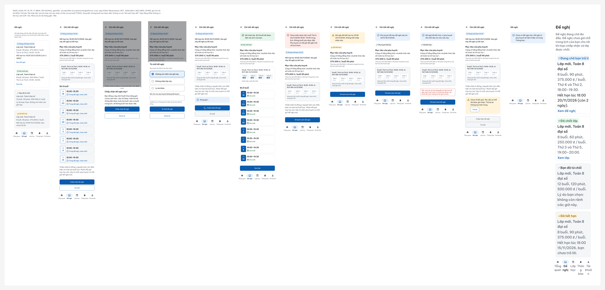

# GS05 Đề nghị nhận lớp

- **Trạng thái thiết kế:** Đã duyệt v1 (Đính, 10/11/2026); khung TBD chưa duyệt
- **Version Figma:** `Lát 1 v1 2026-11-10` (named version lưu tay trong Figma)
- **Node:** section [35:5145](https://www.figma.com/design/uuEo9SH3LxWcFbbHHFFBgl?node-id=35-5145)
- **Kênh:** Android
- **Route (đề xuất, Issue giao diện được chỉnh nếu xung đột router):** `/tutor/offers`, `/tutor/offers/[offerId]`
- **Issue giao diện:** #72
- **Căn cứ:** UC06; FR-16, FR-17; BR05; đặc tả ở [06-man-hinh-lat-1.md](../06-man-hinh-lat-1.md)
- **API:** `listOffers`, `getOffer`, `acceptOffer` (acceptUnchangedTerms), `rejectOffer` (NOT_AVAILABLE, DECLINED, OTHER)

## Ảnh

Ảnh gồm mọi frame trạng thái của section theo thứ tự trong bảng dưới. Xem từng frame ở độ phân giải đầy đủ qua link node.

## Trạng thái

| Frame | Node |
|---|---|
| Đề nghị / Danh sách | [35:3832](https://www.figma.com/design/uuEo9SH3LxWcFbbHHFFBgl?node-id=35-3832) |
| Đề nghị / Chi tiết | [35:3912](https://www.figma.com/design/uuEo9SH3LxWcFbbHHFFBgl?node-id=35-3912) |
| Đề nghị / Xác nhận chấp nhận | [35:4074](https://www.figma.com/design/uuEo9SH3LxWcFbbHHFFBgl?node-id=35-4074) |
| Đề nghị / Từ chối | [35:4163](https://www.figma.com/design/uuEo9SH3LxWcFbbHHFFBgl?node-id=35-4163) |
| Đề nghị / Đang gửi | [35:4279](https://www.figma.com/design/uuEo9SH3LxWcFbbHHFFBgl?node-id=35-4279) |
| Đề nghị / Đã nhận lớp | [35:4371](https://www.figma.com/design/uuEo9SH3LxWcFbbHHFFBgl?node-id=35-4371) |
| Đề nghị / Xung đột lịch | [35:4538](https://www.figma.com/design/uuEo9SH3LxWcFbbHHFFBgl?node-id=35-4538) |
| Đề nghị / Đã hết hạn | [35:4623](https://www.figma.com/design/uuEo9SH3LxWcFbbHHFFBgl?node-id=35-4623) |
| Đề nghị / Phụ huynh đã hủy | [35:4706](https://www.figma.com/design/uuEo9SH3LxWcFbbHHFFBgl?node-id=35-4706) |
| Đề nghị / Đã chốt với gia sư khác | [35:4789](https://www.figma.com/design/uuEo9SH3LxWcFbbHHFFBgl?node-id=35-4789) |
| Đề nghị / Chưa rõ kết quả | [35:4874](https://www.figma.com/design/uuEo9SH3LxWcFbbHHFFBgl?node-id=35-4874) |
| Đề nghị / Rỗng | [35:4964](https://www.figma.com/design/uuEo9SH3LxWcFbbHHFFBgl?node-id=35-4964) |
| Đề nghị / Chữ 200% | [35:5006](https://www.figma.com/design/uuEo9SH3LxWcFbbHHFFBgl?node-id=35-5006) |

Trạng thái chung (tải, lỗi tải, mất quyền, hết phiên, đang gửi, chưa rõ kết quả) theo [04-trang-thai-cau-chu.md](../04-trang-thai-cau-chu.md) khi frame không vẽ riêng.

## Câu chữ

Nguyên văn trong Figma; câu chung lấy từ [04](../04-trang-thai-cau-chu.md). `{…}` là dữ liệu thật thay vào.

| Vị trí | Chuỗi |
|---|---|
| Danh sách | Đề nghị đang chờ lên đầu. Đề nghị chưa giữ chỗ trong lịch của bạn cho tới khi bạn chấp nhận và lớp được chốt. |
| Chi tiết | Hết hạn lúc 18:00 20/11/2026. Sau giờ này đề nghị tự hết hạn. / Chấp nhận là đồng ý nguyên bản các điều kiện và toàn bộ buổi học. Muốn đổi giờ hay học phí, hãy từ chối; phụ huynh có thể gửi đề nghị mới. |
| Bảng chấp nhận | Chấp nhận đề nghị này? Bạn đồng ý dạy đủ 8 buổi theo đúng giờ và học phí trên. Lớp chỉ được chốt khi hệ thống đặt được toàn bộ buổi; nếu có buổi trùng lịch, sẽ không buổi nào được đặt. |
| Bảng từ chối | Từ chối đề nghị. Phụ huynh sẽ thấy lý do bạn chọn. Không còn rảnh các giờ này / Không nhận lớp này / Lý do khác. Ghi chú cho phụ huynh (không bắt buộc): 0/500 ký tự. Không ghi số điện thoại hay liên hệ riêng. |
| Kết quả | Đã nhận lớp. Đủ 8 buổi đã được đặt vào lịch của bạn. / Chưa nhận được lớp: buổi {ngày giờ} trùng lịch. Không buổi nào được đặt. Phụ huynh có thể gửi đề nghị mới với lịch khác. |
| Nút | Chấp nhận đề nghị / Từ chối / Xem lớp / Về danh sách đề nghị |

## Hành vi

- Chỉ báo "Đã nhận lớp" sau khi máy chủ xác nhận cả lớp và mọi buổi (TX05).
- Không có nút "đề xuất thay đổi".

## Ánh xạ sang code

| Figma | Mobile |
|---|---|
| `TopAppBar` | Chưa có trong code, thêm ở Issue giao diện đầu tiên dùng nó (`shared/ui`) |
| `StatusLabel` | Chưa có trong code, thêm ở Issue giao diện đầu tiên dùng nó (`shared/ui`) |
| `PriceBlock` | Chưa có trong code, thêm ở Issue giao diện đầu tiên dùng nó (`shared/ui`) |
| `CycleStrip` | Chưa có trong code, thêm ở Issue giao diện đầu tiên dùng nó (`shared/ui`) |
| `SessionCard` | Chưa có trong code, thêm ở Issue giao diện đầu tiên dùng nó (`shared/ui`) |
| `ConfirmSheet` | Chưa có trong code, thêm ở Issue giao diện đầu tiên dùng nó (`shared/ui`) |
| `ChoiceOption` | Chưa có trong code, thêm ở Issue giao diện đầu tiên dùng nó (`shared/ui`) |
| `TextField` | `TextField.tsx`, `FormTextField` |
| `StickyActionBar` | Chưa có trong code, thêm ở Issue giao diện đầu tiên dùng nó (`shared/ui`) |
| `Notice` | `Notice.tsx` |
| `NavigationBar` | Chưa có trong code, thêm ở Issue giao diện đầu tiên dùng nó (`shared/ui`) |

## Khác so với đặc tả và câu hỏi còn mở

- TBD: OP-25: không có tên học sinh.
- TBD: Mã lý do do hệ thống gắn (đã chốt với gia sư khác) chưa có trong hợp đồng.
