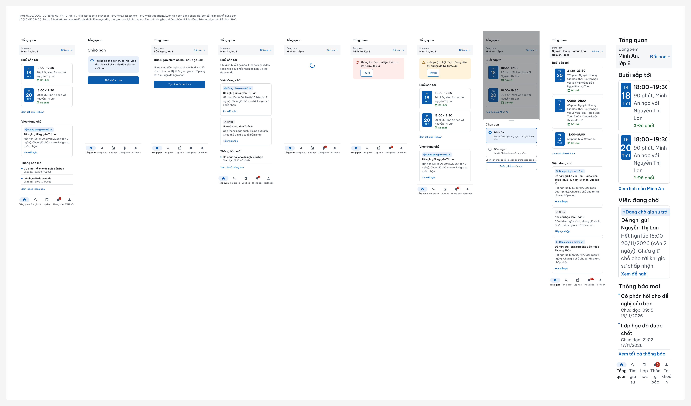

# PH01 Trang chủ phụ huynh

- **Trạng thái thiết kế:** Đã duyệt v1 (Đính, 10/11/2026); khung TBD chưa duyệt
- **Version Figma:** `Lát 1 v1 2026-11-10` (named version lưu tay trong Figma)
- **Node:** section [18:871](https://www.figma.com/design/uuEo9SH3LxWcFbbHHFFBgl?node-id=18-871)
- **Kênh:** Android
- **Route (đề xuất, Issue giao diện được chỉnh nếu xung đột router):** `/parent`
- **Issue giao diện:** TB-14
- **Căn cứ:** UC02, UC07, UC15; FR-03, FR-19, FR-41; đặc tả ở [06-man-hinh-lat-1.md](../06-man-hinh-lat-1.md)
- **API:** `listStudents`, `listNeeds`, `listOffers`, `listSessions`, `listOwnNotifications`

## Ảnh

Ảnh gồm mọi frame trạng thái của section theo thứ tự trong bảng dưới. Xem từng frame ở độ phân giải đầy đủ qua link node.

## Trạng thái

| Frame | Node |
|---|---|
| Trang chủ phụ huynh / Có dữ liệu | [18:2](https://www.figma.com/design/uuEo9SH3LxWcFbbHHFFBgl?node-id=18-2) |
| Trang chủ phụ huynh / Chưa có con | [18:109](https://www.figma.com/design/uuEo9SH3LxWcFbbHHFFBgl?node-id=18-109) |
| Trang chủ phụ huynh / Con chưa có nhu cầu | [18:156](https://www.figma.com/design/uuEo9SH3LxWcFbbHHFFBgl?node-id=18-156) |
| Trang chủ phụ huynh / Chưa có lớp | [18:203](https://www.figma.com/design/uuEo9SH3LxWcFbbHHFFBgl?node-id=18-203) |
| Trang chủ phụ huynh / Đang tải | [18:282](https://www.figma.com/design/uuEo9SH3LxWcFbbHHFFBgl?node-id=18-282) |
| Trang chủ phụ huynh / Lỗi tải | [18:327](https://www.figma.com/design/uuEo9SH3LxWcFbbHHFFBgl?node-id=18-327) |
| Trang chủ phụ huynh / Dữ liệu cũ | [18:379](https://www.figma.com/design/uuEo9SH3LxWcFbbHHFFBgl?node-id=18-379) |
| Trang chủ phụ huynh / Đổi con | [18:471](https://www.figma.com/design/uuEo9SH3LxWcFbbHHFFBgl?node-id=18-471) |
| Trang chủ phụ huynh / Dữ liệu xấu nhất | [18:573](https://www.figma.com/design/uuEo9SH3LxWcFbbHHFFBgl?node-id=18-573) |
| Trang chủ phụ huynh / Chữ 200% | [18:688](https://www.figma.com/design/uuEo9SH3LxWcFbbHHFFBgl?node-id=18-688) |

Trạng thái chung (tải, lỗi tải, mất quyền, hết phiên, đang gửi, chưa rõ kết quả) theo [04-trang-thai-cau-chu.md](../04-trang-thai-cau-chu.md) khi frame không vẽ riêng.

## Câu chữ

Nguyên văn trong Figma; câu chung lấy từ [04](../04-trang-thai-cau-chu.md). `{…}` là dữ liệu thật thay vào.

| Vị trí | Chuỗi |
|---|---|
| Khối | Buổi sắp tới / Việc đang chờ / Thông báo mới |
| Đề nghị chờ | Đề nghị gửi Nguyễn Thị Lan. Hết hạn lúc 18:00 20/11/2026 (còn 2 ngày). Chưa giữ chỗ cho tới khi gia sư chấp nhận. Nút: Xem đề nghị |
| Nhu cầu nháp | Nhu cầu học kèm Toán 8. Cần thêm: ngân sách, khung giờ rảnh. Chưa thể tìm gia sư từ bản nháp. Nút: Tiếp tục nhập |
| Chưa có con | Tạo hồ sơ cho con trước. Mọi việc tìm gia sư, lịch và lớp đều gắn với một con. Nút: Thêm hồ sơ con |
| Chưa có lớp | Chưa có buổi học nào. Lịch sẽ hiện ở đây sau khi gia sư chấp nhận đề nghị và lớp được chốt. |
| Bảng chọn con | Chọn con / Chọn con khác sẽ tải lại toàn bộ trang theo con đó. / Quản lý hồ sơ các con |

## Hành vi

- Đổi con tải lại mọi khối đúng con đó (AC-UC02-01).
- Tối đa 3 buổi sắp tới; "Xem lịch của {con}".
- Số chưa đọc trên 99 hiện "99+".

## Ánh xạ sang code

| Figma | Mobile |
|---|---|
| `TopAppBar` | Chưa có trong code, thêm ở Issue giao diện đầu tiên dùng nó (`shared/ui`) |
| `StudentSwitcher` | Chưa có trong code, thêm ở Issue giao diện đầu tiên dùng nó (`shared/ui`) |
| `SessionCard` | Chưa có trong code, thêm ở Issue giao diện đầu tiên dùng nó (`shared/ui`) |
| `StatusLabel` | Chưa có trong code, thêm ở Issue giao diện đầu tiên dùng nó (`shared/ui`) |
| `Notice` | `Notice.tsx` |
| `ChoiceOption` | Chưa có trong code, thêm ở Issue giao diện đầu tiên dùng nó (`shared/ui`) |
| `NavigationBar` | `NavigationBar.tsx` (#95 phần 1b); tab theo vai trò gắn ở Issue màn hình |

## Khác so với đặc tả và câu hỏi còn mở

- TBD: OP-27: buổi sắp tới cần classId, Lát 1 không có thao tác liệt kê lớp.
- Code TB-14a (#192), Đính quyết ngày 22/11/2026:
  - Dòng phụ của lựa chọn trong bảng chọn con chỉ hiện "Lớp {lớp}.", là phần đầu của câu đã duyệt. Thêm số lớp đang học và đề nghị đang chờ khi các API đó merge.
  - Tiêu đề "Tổng quan" là tiêu đề lớn của `QueryScreen`, khác thanh tiêu đề nhỏ của bản duyệt. Thanh tiêu đề dùng chung cho mọi màn `QueryScreen`, nên sửa ở Issue riêng.
  - Khối nhu cầu làm ở #70 cùng PH03–PH05; TB-14 không làm. Các khối đề nghị, buổi sắp tới, thông báo ẩn tới khi API của chúng merge (Đính, #14, 15/11/2026).
  - Tab "Tài khoản" mở một màn danh sách mục (Hồ sơ các con, Bảo mật và phiên); Đính thiết kế frame này, khung tab làm ở Issue sau. Tới lúc đó PH01 giữ nút tạm "Bảo mật".
- Khối nhu cầu, code #70 (PR 6):
  - Con chưa có nhu cầu nào: frame "Con chưa có nhu cầu", nút "Tạo nhu cầu học kèm" mở PH04.
  - Con có bản nháp: thẻ "Nhu cầu nháp" dưới "Việc đang chờ", nút "Tiếp tục nhập" mở PH04 của bản nháp. "Cần thêm" kể các ô còn trống của PH04 và "khung giờ rảnh" khi lịch của con chưa có giờ rảnh (#16 Q1). Lịch đang tải hoặc tải lỗi thì không nêu giờ rảnh, vì chưa biết có thiếu hay không. Bản nháp đủ ô chỉ còn "Chưa thể tìm gia sư từ bản nháp."
  - Nhu cầu đã xác nhận hoặc đã đóng không hiện gì ở PH01. Đề nghị của nhu cầu đó thuộc khối đề nghị, vẫn ẩn tới khi API của nó merge.
