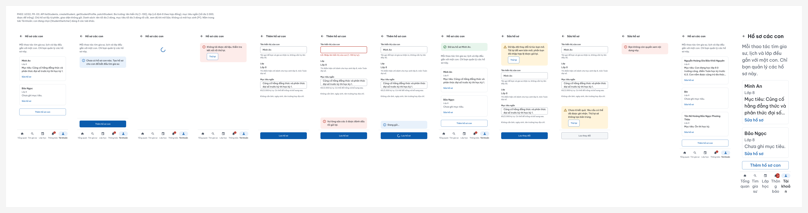

# PH02 Hồ sơ các con

- **Trạng thái thiết kế:** Đã duyệt v1 (Đính, 10/11/2026)
- **Version Figma:** `Lát 1 v1 2026-11-10` (named version lưu tay trong Figma)
- **Node:** section [15:1418](https://www.figma.com/design/uuEo9SH3LxWcFbbHHFFBgl?node-id=15-1418)
- **Kênh:** Android
- **Route (đề xuất, Issue giao diện được chỉnh nếu xung đột router):** `/parent/account/students`
- **Issue giao diện:** #67
- **Căn cứ:** UC02; FR-03; đặc tả ở [06-man-hinh-lat-1.md](../06-man-hinh-lat-1.md)
- **API:** `listStudents`, `createStudent`, `getStudentProfile`, `patchStudent`

## Ảnh

Ảnh gồm mọi frame trạng thái của section theo thứ tự trong bảng dưới. Xem từng frame ở độ phân giải đầy đủ qua link node.

## Trạng thái

| Frame | Node |
|---|---|
| Hồ sơ các con / Danh sách | [15:788](https://www.figma.com/design/uuEo9SH3LxWcFbbHHFFBgl?node-id=15-788) |
| Hồ sơ các con / Rỗng | [15:841](https://www.figma.com/design/uuEo9SH3LxWcFbbHHFFBgl?node-id=15-841) |
| Hồ sơ các con / Đang tải | [15:891](https://www.figma.com/design/uuEo9SH3LxWcFbbHHFFBgl?node-id=15-891) |
| Hồ sơ các con / Lỗi tải | [15:931](https://www.figma.com/design/uuEo9SH3LxWcFbbHHFFBgl?node-id=15-931) |
| Thêm hồ sơ con / Mặc định | [15:977](https://www.figma.com/design/uuEo9SH3LxWcFbbHHFFBgl?node-id=15-977) |
| Thêm hồ sơ con / Lỗi trường | [15:1011](https://www.figma.com/design/uuEo9SH3LxWcFbbHHFFBgl?node-id=15-1011) |
| Thêm hồ sơ con / Đang gửi | [15:1053](https://www.figma.com/design/uuEo9SH3LxWcFbbHHFFBgl?node-id=15-1053) |
| Hồ sơ các con / Đã lưu | [15:1097](https://www.figma.com/design/uuEo9SH3LxWcFbbHHFFBgl?node-id=15-1097) |
| Sửa hồ sơ / Bản cũ | [15:1158](https://www.figma.com/design/uuEo9SH3LxWcFbbHHFFBgl?node-id=15-1158) |
| Sửa hồ sơ / Chưa rõ kết quả | [15:1199](https://www.figma.com/design/uuEo9SH3LxWcFbbHHFFBgl?node-id=15-1199) |
| Hồ sơ các con / Mất quyền | [15:1242](https://www.figma.com/design/uuEo9SH3LxWcFbbHHFFBgl?node-id=15-1242) |
| Hồ sơ các con / Dữ liệu xấu nhất | [15:1259](https://www.figma.com/design/uuEo9SH3LxWcFbbHHFFBgl?node-id=15-1259) |
| Hồ sơ các con / Chữ 200% | [15:1318](https://www.figma.com/design/uuEo9SH3LxWcFbbHHFFBgl?node-id=15-1318) |

Trạng thái chung (tải, lỗi tải, mất quyền, hết phiên, đang gửi, chưa rõ kết quả) theo [04-trang-thai-cau-chu.md](../04-trang-thai-cau-chu.md) khi frame không vẽ riêng.

## Câu chữ

Nguyên văn trong Figma; câu chung lấy từ [04](../04-trang-thai-cau-chu.md). `{…}` là dữ liệu thật thay vào.

| Vị trí | Chuỗi |
|---|---|
| Dẫn | Mỗi thao tác tìm gia sư, lịch và lớp đều gắn với một con. Chỉ bạn quản lý các hồ sơ này. |
| Thẻ | {tên} / Lớp 8 / Mục tiêu: … (hoặc "Chưa ghi mục tiêu.") / Sửa hồ sơ |
| Rỗng | Chưa có hồ sơ con nào. Tạo hồ sơ cho con để bắt đầu tìm gia sư. |
| Ô | Tên hiển thị của con (Tên gọi để bạn và gia sư nhận ra, không cần họ tên đầy đủ.) / Lớp: Lớp 8 (Thí điểm hiện chỉ dành cho học sinh lớp 8, môn Toán đại số.) / Mục tiêu ngắn (…/2.000 ký tự. Có thể để trống và bổ sung sau.) |
| Ghi chú | Không cần ảnh, ngày sinh, tên trường hay địa chỉ. |
| Nút | Thêm hồ sơ con / Lưu hồ sơ / Lưu thay đổi |
| Lỗi | Lỗi: Nhập tên hiển thị của con (1–100 ký tự). |
| Đã lưu | Đã lưu hồ sơ {tên}. |

## Hành vi

- Trong danh sách: tên tối đa 2 dòng, mục tiêu tối đa 3 dòng rồi cắt; xem đủ khi mở Sửa.
- Lớp cố định 8 theo hợp đồng, không là ô nhập.

## Ánh xạ sang code

| Figma | Mobile |
|---|---|
| `TopAppBar` | Chưa có trong code, thêm ở Issue giao diện đầu tiên dùng nó (`shared/ui`) |
| `TextField` | `TextField.tsx`, `FormTextField` |
| `StickyActionBar` | Chưa có trong code, thêm ở Issue giao diện đầu tiên dùng nó (`shared/ui`) |
| `Notice` | `Notice.tsx` |
| `Button` | `Button.tsx` (variant, busy, disabled) |
| `NavigationBar` | Chưa có trong code, thêm ở Issue giao diện đầu tiên dùng nó (`shared/ui`) |

## Khác so với đặc tả và câu hỏi còn mở

Không có.
