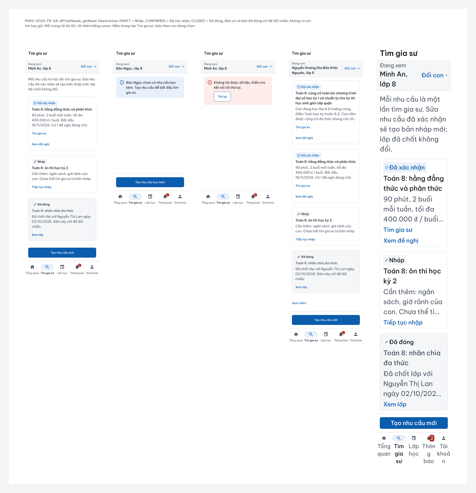

# PH03 Danh sách và phiên bản nhu cầu

- **Trạng thái thiết kế:** Đã duyệt v1 (Đính, 10/11/2026)
- **Version Figma:** `Lát 1 v1 2026-11-10` (named version lưu tay trong Figma)
- **Node:** section [29:2132](https://www.figma.com/design/uuEo9SH3LxWcFbbHHFFBgl?node-id=29-2132)
- **Kênh:** Android
- **Route (đề xuất, Issue giao diện được chỉnh nếu xung đột router):** `/parent/needs`
- **Issue giao diện:** #70
- **Căn cứ:** UC04; FR-04; đặc tả ở [06-man-hinh-lat-1.md](../06-man-hinh-lat-1.md)
- **API:** `listNeeds`, `getNeed`

## Ảnh

Ảnh gồm mọi frame trạng thái của section theo thứ tự trong bảng dưới. Xem từng frame ở độ phân giải đầy đủ qua link node.

## Trạng thái

| Frame | Node |
|---|---|
| Nhu cầu của con / Danh sách | [29:1700](https://www.figma.com/design/uuEo9SH3LxWcFbbHHFFBgl?node-id=29-1700) |
| Nhu cầu của con / Rỗng | [29:1784](https://www.figma.com/design/uuEo9SH3LxWcFbbHHFFBgl?node-id=29-1784) |
| Nhu cầu của con / Lỗi tải | [29:1838](https://www.figma.com/design/uuEo9SH3LxWcFbbHHFFBgl?node-id=29-1838) |
| Nhu cầu của con / Dữ liệu xấu nhất | [29:1888](https://www.figma.com/design/uuEo9SH3LxWcFbbHHFFBgl?node-id=29-1888) |
| Nhu cầu của con / Chữ 200% | [29:1980](https://www.figma.com/design/uuEo9SH3LxWcFbbHHFFBgl?node-id=29-1980) |

Trạng thái chung (tải, lỗi tải, mất quyền, hết phiên, đang gửi, chưa rõ kết quả) theo [04-trang-thai-cau-chu.md](../04-trang-thai-cau-chu.md) khi frame không vẽ riêng.

## Câu chữ

Nguyên văn trong Figma; câu chung lấy từ [04](../04-trang-thai-cau-chu.md). `{…}` là dữ liệu thật thay vào.

| Vị trí | Chuỗi |
|---|---|
| Dẫn | Mỗi nhu cầu là một lần tìm gia sư. Sửa nhu cầu đã xác nhận sẽ tạo bản nháp mới; lớp đã chốt không đổi. |
| Nhãn | Nháp / Đã xác nhận / Đã đóng |
| Hành động | Tìm gia sư / Xem đề nghị / Tiếp tục nhập / Xem lớp |
| Rỗng | {con} chưa có nhu cầu học kèm. Tạo nhu cầu để bắt đầu tìm gia sư. |
| Nút | Tạo nhu cầu mới |

## Hành vi

- Bản đã đóng chỉ để đối chiếu, không có nút tìm hay gửi.
- Tối đa 50 mỗi trang, "Xem thêm" theo cursor.

## Ánh xạ sang code

| Figma | Mobile |
|---|---|
| `TopAppBar` | Chưa có trong code, thêm ở Issue giao diện đầu tiên dùng nó (`shared/ui`) |
| `StudentSwitcher` | Chưa có trong code, thêm ở Issue giao diện đầu tiên dùng nó (`shared/ui`) |
| `StatusLabel` | Chưa có trong code, thêm ở Issue giao diện đầu tiên dùng nó (`shared/ui`) |
| `StickyActionBar` | Chưa có trong code, thêm ở Issue giao diện đầu tiên dùng nó (`shared/ui`) |
| `Notice` | `Notice.tsx` |
| `NavigationBar` | Chưa có trong code, thêm ở Issue giao diện đầu tiên dùng nó (`shared/ui`) |

## Khác so với đặc tả và câu hỏi còn mở

Không có.
