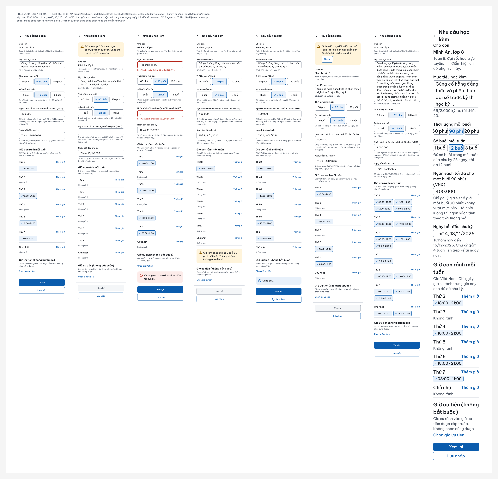

# PH04 Nhập nhu cầu học kèm

- **Trạng thái thiết kế:** Đã duyệt v1 (Đính, 10/11/2026)
- **Version Figma:** `Lát 1 v1 2026-11-10` (named version lưu tay trong Figma)
- **Node:** section [28:2600](https://www.figma.com/design/uuEo9SH3LxWcFbbHHFFBgl?node-id=28-2600)
- **Kênh:** Android
- **Route (đề xuất, Issue giao diện được chỉnh nếu xung đột router):** `/parent/needs/[needId]/edit`, `/parent/needs/new`
- **Issue giao diện:** #70
- **Căn cứ:** UC04, UC07; FR-04, FR-19; BR02, BR04; đặc tả ở [06-man-hinh-lat-1.md](../06-man-hinh-lat-1.md)
- **API:** `createNeedDraft`, `updateNeedDraft`, `getStudentCalendar`, `replaceStudentCalendar`

## Ảnh

Ảnh gồm mọi frame trạng thái của section theo thứ tự trong bảng dưới. Xem từng frame ở độ phân giải đầy đủ qua link node.

## Trạng thái

| Frame | Node |
|---|---|
| Nhập nhu cầu / Đang nhập | [28:1396](https://www.figma.com/design/uuEo9SH3LxWcFbbHHFFBgl?node-id=28-1396) |
| Nhập nhu cầu / Nháp chưa đủ điều kiện | [28:1530](https://www.figma.com/design/uuEo9SH3LxWcFbbHHFFBgl?node-id=28-1530) |
| Nhập nhu cầu / Lỗi trường | [28:1655](https://www.figma.com/design/uuEo9SH3LxWcFbbHHFFBgl?node-id=28-1655) |
| Nhập nhu cầu / Giờ rảnh chưa đủ | [28:1797](https://www.figma.com/design/uuEo9SH3LxWcFbbHHFFBgl?node-id=28-1797) |
| Nhập nhu cầu / Đang lưu nháp | [28:1926](https://www.figma.com/design/uuEo9SH3LxWcFbbHHFFBgl?node-id=28-1926) |
| Nhập nhu cầu / Bản cũ | [28:2070](https://www.figma.com/design/uuEo9SH3LxWcFbbHHFFBgl?node-id=28-2070) |
| Nhập nhu cầu / Dữ liệu xấu nhất | [28:2211](https://www.figma.com/design/uuEo9SH3LxWcFbbHHFFBgl?node-id=28-2211) |
| Nhập nhu cầu / Chữ 200% | [28:2396](https://www.figma.com/design/uuEo9SH3LxWcFbbHHFFBgl?node-id=28-2396) |

Trạng thái chung (tải, lỗi tải, mất quyền, hết phiên, đang gửi, chưa rõ kết quả) theo [04-trang-thai-cau-chu.md](../04-trang-thai-cau-chu.md) khi frame không vẽ riêng.

## Câu chữ

Nguyên văn trong Figma; câu chung lấy từ [04](../04-trang-thai-cau-chu.md). `{…}` là dữ liệu thật thay vào.

| Vị trí | Chuỗi |
|---|---|
| Cho con | Minh An, lớp 8. Toán 8, đại số, học trực tuyến. Thí điểm hiện chỉ có phạm vi này. |
| Ô | Mục tiêu học kèm (…/2.000 ký tự, tối thiểu 20.) / Thời lượng mỗi buổi: 60, 90, 120 phút / Số buổi mỗi tuần: 1, 2, 3 buổi (Đủ số buổi trong mỗi tuần của chu kỳ 28 ngày, tối đa 12 buổi.) / Ngân sách tối đa cho một buổi 90 phút (VND) / Ngày bắt đầu chu kỳ (Từ hôm nay đến {ngày + 28}. Chu kỳ gồm 4 tuần liên tiếp kể từ ngày này.) |
| Giờ rảnh | Giờ con rảnh mỗi tuần. Giờ Việt Nam. Chỉ gợi ý gia sư rảnh trùng giờ này cho đủ cả chu kỳ. / Giờ ưu tiên (không bắt buộc) |
| Nháp thiếu | Đã lưu nháp. Cần thêm: ngân sách, giờ rảnh của con. Chưa thể tìm gia sư từ bản nháp. |
| Giờ chưa đủ | Giờ rảnh chưa đủ cho 2 buổi 90 phút mỗi tuần. Thêm giờ rảnh hoặc giảm số buổi. |
| Lỗi | Lỗi: Mục tiêu cần ít nhất 20 ký tự (hiện 14). / Lỗi: Ngân sách phải là số nguyên lớn hơn 0. |
| Lịch có ngoại lệ | Lịch rảnh của con có ngày khác mẫu tuần. Lưu ở đây sẽ thay toàn bộ lịch bằng mẫu tuần dưới đây. (Figma v1 chưa vẽ trạng thái này; Đính duyệt câu chữ ngày 26/11/2026, #70 Q2) |
| Nút | Xem lại / Lưu nháp |

## Hành vi

- Nhãn ngân sách đổi theo thời lượng đang chọn.
- Thiếu điều kiện vẫn lưu nháp; nút Xem lại vô hiệu kèm lý do.

## Ánh xạ sang code

| Figma | Mobile |
|---|---|
| `TopAppBar` | Chưa có trong code, thêm ở Issue giao diện đầu tiên dùng nó (`shared/ui`) |
| `TextField` | `TextField.tsx`, `FormTextField` |
| `TimeChip` | `TimeChip.tsx` (draft, effective, booked; nút × bỏ khung) |
| `StickyActionBar` | Chưa có trong code, thêm ở Issue giao diện đầu tiên dùng nó (`shared/ui`) |
| `Notice` | `Notice.tsx` |
| `Button` | `Button.tsx` (variant, busy, disabled) |

## Khác so với đặc tả và câu hỏi còn mở

- Bỏ một khung giờ (Đính chốt #70 Q3, 26/11/2026; Figma v1 chưa vẽ): nút × (icon `close` của Material Symbols) ở cuối `TimeChip`, vùng chạm tối thiểu 48dp, nhãn trình đọc màn hình "Bỏ khung {thứ} {giờ}", ví dụ "Bỏ khung Thứ 2 18:00–19:30". Chip "đã có buổi" không có nút × (UC07). Việc bỏ chỉ có hiệu lực khi bấm Lưu. Nhấn vào thân chip không làm gì.
