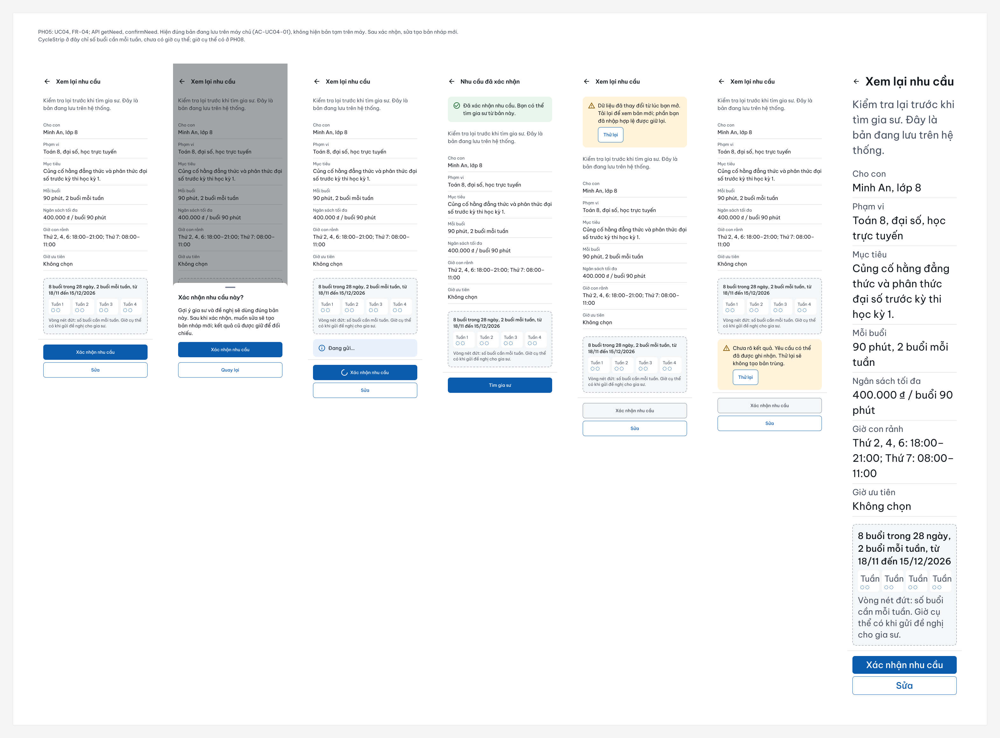

# PH05 Xem lại và xác nhận nhu cầu

- **Trạng thái thiết kế:** Đã duyệt v1 (Đính, 10/11/2026)
- **Version Figma:** `Lát 1 v1 2026-11-10` (named version lưu tay trong Figma)
- **Node:** section [29:2652](https://www.figma.com/design/uuEo9SH3LxWcFbbHHFFBgl?node-id=29-2652)
- **Kênh:** Android
- **Route (đề xuất, Issue giao diện được chỉnh nếu xung đột router):** `/parent/needs/[needId]/review`
- **Issue giao diện:** #70
- **Căn cứ:** UC04; FR-04; đặc tả ở [06-man-hinh-lat-1.md](../06-man-hinh-lat-1.md)
- **API:** `getNeed`, `confirmNeed`

## Ảnh

Ảnh gồm mọi frame trạng thái của section theo thứ tự trong bảng dưới. Xem từng frame ở độ phân giải đầy đủ qua link node.

## Trạng thái

| Frame | Node |
|---|---|
| Xem lại nhu cầu / Mặc định | [29:2134](https://www.figma.com/design/uuEo9SH3LxWcFbbHHFFBgl?node-id=29-2134) |
| Xem lại nhu cầu / Xác nhận | [29:2196](https://www.figma.com/design/uuEo9SH3LxWcFbbHHFFBgl?node-id=29-2196) |
| Xem lại nhu cầu / Đang gửi | [29:2269](https://www.figma.com/design/uuEo9SH3LxWcFbbHHFFBgl?node-id=29-2269) |
| Xem lại nhu cầu / Đã xác nhận | [29:2341](https://www.figma.com/design/uuEo9SH3LxWcFbbHHFFBgl?node-id=29-2341) |
| Xem lại nhu cầu / Bản cũ | [29:2409](https://www.figma.com/design/uuEo9SH3LxWcFbbHHFFBgl?node-id=29-2409) |
| Xem lại nhu cầu / Chưa rõ kết quả | [29:2479](https://www.figma.com/design/uuEo9SH3LxWcFbbHHFFBgl?node-id=29-2479) |
| Xem lại nhu cầu / Chữ 200% | [29:2550](https://www.figma.com/design/uuEo9SH3LxWcFbbHHFFBgl?node-id=29-2550) |

Trạng thái chung (tải, lỗi tải, mất quyền, hết phiên, đang gửi, chưa rõ kết quả) theo [04-trang-thai-cau-chu.md](../04-trang-thai-cau-chu.md) khi frame không vẽ riêng.

## Câu chữ

Nguyên văn trong Figma; câu chung lấy từ [04](../04-trang-thai-cau-chu.md). `{…}` là dữ liệu thật thay vào.

| Vị trí | Chuỗi |
|---|---|
| Dẫn | Kiểm tra lại trước khi tìm gia sư. Đây là bản đang lưu trên hệ thống. |
| Dòng | Cho con / Phạm vi / Mục tiêu / Mỗi buổi / Ngân sách tối đa / Giờ con rảnh / Giờ ưu tiên |
| CycleStrip | Vòng nét đứt: số buổi cần mỗi tuần. Giờ cụ thể có khi gửi đề nghị cho gia sư. |
| Bảng xác nhận | Xác nhận nhu cầu này? Gợi ý gia sư và đề nghị sẽ dùng đúng bản này. Sau khi xác nhận, muốn sửa sẽ tạo bản nháp mới; kết quả cũ được giữ để đối chiếu. |
| Đã xác nhận | Đã xác nhận nhu cầu. Bạn có thể tìm gia sư từ bản này. Nút: Tìm gia sư |
| Nút | Xác nhận nhu cầu / Sửa |

## Hành vi

- Hiện bản máy chủ đang lưu (AC-UC04-01), không hiện bản tạm trên máy.

## Ánh xạ sang code

| Figma | Mobile |
|---|---|
| `TopAppBar` | Chưa có trong code, thêm ở Issue giao diện đầu tiên dùng nó (`shared/ui`) |
| `StudentSwitcher` | Chưa có trong code, thêm ở Issue giao diện đầu tiên dùng nó (`shared/ui`) |
| `CycleStrip` | `CycleStrip.tsx` (#70 PR 4: tiêu đề, 4 khối tuần, vòng nét đứt; dấu buổi đã qua, đã hủy thêm ở PH08, CL02) |
| `ConfirmSheet` | `ConfirmSheet.tsx` |
| `StickyActionBar` | `StickyActionBar.tsx` |
| `Notice` | `Notice.tsx` |

## Khác so với đặc tả và câu hỏi còn mở

- Code của #70 PR 4 khác Figma v1 (28/11/2026):
  - Nháp còn thiếu trường hoặc con chưa có giờ rảnh (mở thẳng route, PH04 không cho đi tới đây khi còn thiếu): hiện câu "Nháp thiếu" của PH04 ("Đã lưu nháp. Cần thêm: …") và vô hiệu "Xác nhận nhu cầu". Figma chỉ vẽ bản đủ.
  - Mở một nhu cầu đã xác nhận: tiêu đề "Nhu cầu đã xác nhận" và nút "Tìm gia sư" như frame "Đã xác nhận", nhưng không có Notice "Đã xác nhận nhu cầu…" (Notice chỉ hiện ngay sau khi xác nhận). Nhu cầu đã đóng: không có nút.
  - "Bản cũ": nút "Tải lại" như GS02, GS04, PH04; frame v1 ghi "Thử lại". Tải lại thì màn hiện bản mới nhất, và lần xác nhận sau dùng ETag của bản đó.
  - "Giờ con rảnh", "Giờ ưu tiên" đọc từ lịch hiện hành của con, gom các ngày cùng khung giờ ("Thứ 2, 4, 6: 18:00–21:00; Thứ 7: 08:00–11:00"); không chọn thì "Không chọn". Nhiều khung trong một ngày nối bằng "và".
