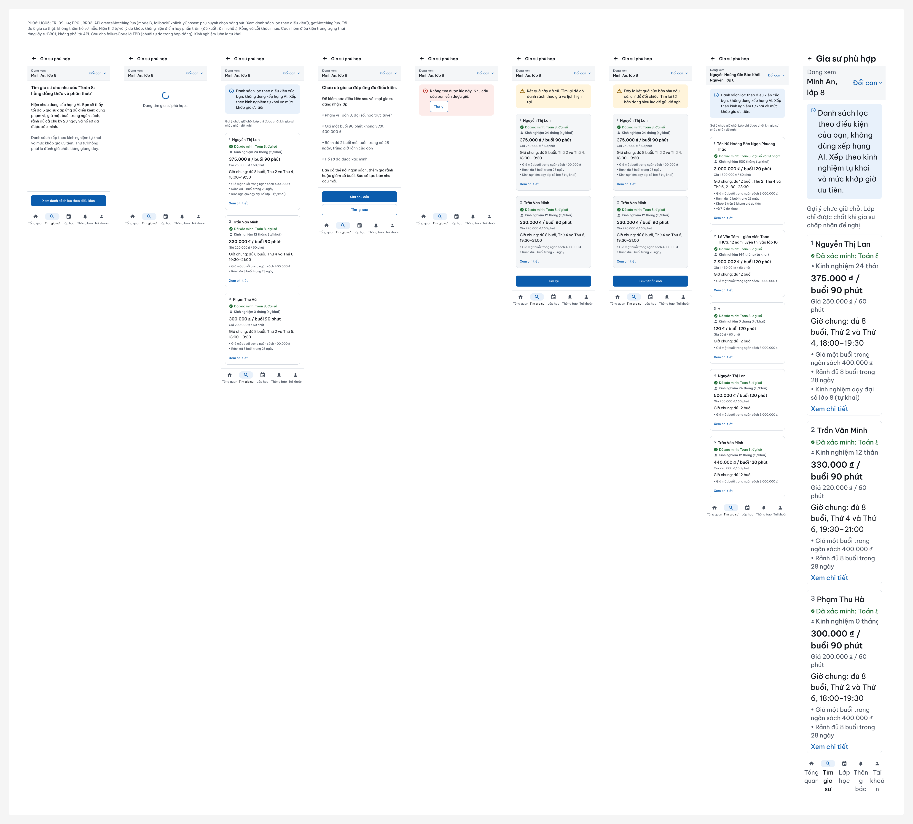

# PH06 Kết quả và so sánh gia sư

- **Trạng thái thiết kế:** Đã duyệt v1 (Đính, 10/11/2026); khung TBD chưa duyệt
- **Version Figma:** `Lát 1 v1 2026-11-10` (named version lưu tay trong Figma)
- **Node:** section [30:3029](https://www.figma.com/design/uuEo9SH3LxWcFbbHHFFBgl?node-id=30-3029)
- **Kênh:** Android
- **Route (đề xuất, Issue giao diện được chỉnh nếu xung đột router):** `/parent/needs/[needId]/matches`
- **Issue giao diện:** #71
- **Căn cứ:** UC05; FR-09–14; BR01, BR03; đặc tả ở [06-man-hinh-lat-1.md](../06-man-hinh-lat-1.md)
- **API:** `createMatchingRun` (mode B, `fallbackExplicitlyChosen`), `getMatchingRun`

## Ảnh

Ảnh gồm mọi frame trạng thái của section theo thứ tự trong bảng dưới. Xem từng frame ở độ phân giải đầy đủ qua link node.

## Trạng thái

| Frame | Node |
|---|---|
| Gợi ý gia sư / Chọn cách tìm | [30:2099](https://www.figma.com/design/uuEo9SH3LxWcFbbHHFFBgl?node-id=30-2099) |
| Gợi ý gia sư / Đang tìm | [30:2151](https://www.figma.com/design/uuEo9SH3LxWcFbbHHFFBgl?node-id=30-2151) |
| Gợi ý gia sư / Kết quả | [30:2200](https://www.figma.com/design/uuEo9SH3LxWcFbbHHFFBgl?node-id=30-2200) |
| Gợi ý gia sư / Không có gia sư | [30:2323](https://www.figma.com/design/uuEo9SH3LxWcFbbHHFFBgl?node-id=30-2323) |
| Gợi ý gia sư / Lỗi | [30:2381](https://www.figma.com/design/uuEo9SH3LxWcFbbHHFFBgl?node-id=30-2381) |
| Gợi ý gia sư / Kết quả đã cũ | [30:2434](https://www.figma.com/design/uuEo9SH3LxWcFbbHHFFBgl?node-id=30-2434) |
| Gợi ý gia sư / Nhu cầu là bản cũ | [30:2535](https://www.figma.com/design/uuEo9SH3LxWcFbbHHFFBgl?node-id=30-2535) |
| Gợi ý gia sư / Dữ liệu xấu nhất | [30:2636](https://www.figma.com/design/uuEo9SH3LxWcFbbHHFFBgl?node-id=30-2636) |
| Gợi ý gia sư / Chữ 200% | [30:2798](https://www.figma.com/design/uuEo9SH3LxWcFbbHHFFBgl?node-id=30-2798) |

Trạng thái chung (tải, lỗi tải, mất quyền, hết phiên, đang gửi, chưa rõ kết quả) theo [04-trang-thai-cau-chu.md](../04-trang-thai-cau-chu.md) khi frame không vẽ riêng.

## Câu chữ

Nguyên văn trong Figma; câu chung lấy từ [04](../04-trang-thai-cau-chu.md). `{…}` là dữ liệu thật thay vào.

| Vị trí | Chuỗi |
|---|---|
| Chọn cách tìm | Hiện chưa dùng xếp hạng AI. Bạn sẽ thấy tối đa 5 gia sư đáp ứng đủ điều kiện: đúng phạm vi, giá một buổi trong ngân sách, rảnh đủ cả chu kỳ 28 ngày và hồ sơ đã được xác minh. / Danh sách xếp theo kinh nghiệm tự khai và mức khớp giờ ưu tiên. Thứ tự không phải là đánh giá chất lượng giảng dạy. Nút: Xem danh sách lọc theo điều kiện |
| Đầu kết quả | Danh sách lọc theo điều kiện của bạn, không dùng xếp hạng AI. Xếp theo kinh nghiệm tự khai và mức khớp giờ ưu tiên. / Gợi ý chưa giữ chỗ. Lớp chỉ được chốt khi gia sư chấp nhận đề nghị. |
| Thẻ | thứ tự, tên, Đã xác minh: {phạm vi}, Kinh nghiệm {n} tháng (tự khai), giá buổi, Giờ chung, lý do khớp, Xem chi tiết |
| Đang tìm | Đang tìm gia sư phù hợp… (không phần trăm) |
| Không có | Chưa có gia sư đáp ứng đủ điều kiện. + 4 nhóm điều kiện đã kiểm. Nút: Sửa nhu cầu / Tìm lại sau |
| Lỗi | Không tìm được lúc này. Nhu cầu của bạn vẫn được giữ. |
| Đã cũ | Kết quả này đã cũ. Tìm lại để có danh sách theo giá và lịch hiện tại. |

## Hành vi

- Không hiện điểm hay phần trăm.
- Lý do dài: hiện 3, phần còn lại "và n lý do khác".

## Ánh xạ sang code

| Figma | Mobile |
|---|---|
| `TopAppBar` | Chưa có trong code, thêm ở Issue giao diện đầu tiên dùng nó (`shared/ui`) |
| `StudentSwitcher` | Chưa có trong code, thêm ở Issue giao diện đầu tiên dùng nó (`shared/ui`) |
| `VerificationLabel` | Chưa có trong code, thêm ở Issue giao diện đầu tiên dùng nó (`shared/ui`) |
| `PriceBlock` | Chưa có trong code, thêm ở Issue giao diện đầu tiên dùng nó (`shared/ui`) |
| `Notice` | `Notice.tsx` |
| `StickyActionBar` | Chưa có trong code, thêm ở Issue giao diện đầu tiên dùng nó (`shared/ui`) |
| `NavigationBar` | Chưa có trong code, thêm ở Issue giao diện đầu tiên dùng nó (`shared/ui`) |

## Khác so với đặc tả và câu hỏi còn mở

- TBD: failureCode là chuỗi tự do: câu chữ lỗi chi tiết là đề xuất.
