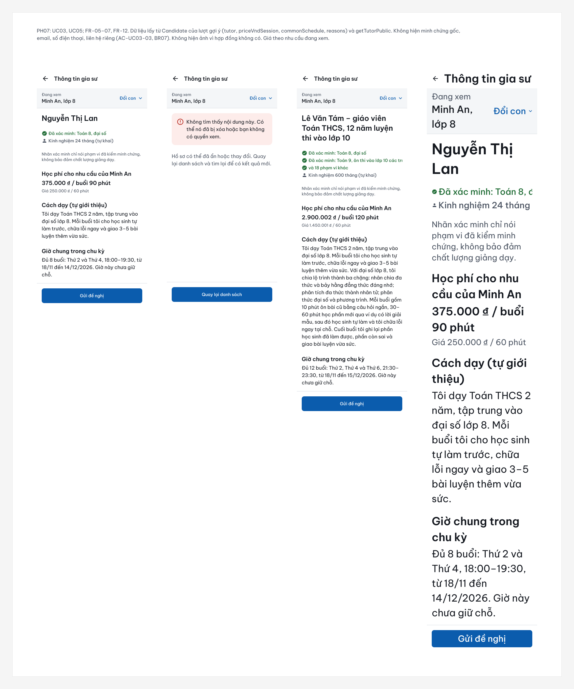

# PH07 Chi tiết gia sư công khai

- **Trạng thái thiết kế:** Đã duyệt v1 (Đính, 10/11/2026)
- **Version Figma:** `Lát 1 v1 2026-11-10` (named version lưu tay trong Figma)
- **Node:** section [31:2731](https://www.figma.com/design/uuEo9SH3LxWcFbbHHFFBgl?node-id=31-2731)
- **Kênh:** Android
- **Route (đề xuất, Issue giao diện được chỉnh nếu xung đột router):** `/parent/tutors/[tutorId]`
- **Issue giao diện:** #71
- **Căn cứ:** UC03, UC05; FR-05–07, FR-12; đặc tả ở [06-man-hinh-lat-1.md](../06-man-hinh-lat-1.md)
- **API:** `getTutorPublic` và Candidate của lượt gợi ý

## Ảnh

Ảnh gồm mọi frame trạng thái của section theo thứ tự trong bảng dưới. Xem từng frame ở độ phân giải đầy đủ qua link node.

## Trạng thái

| Frame | Node |
|---|---|
| Chi tiết gia sư / Mặc định | [31:2528](https://www.figma.com/design/uuEo9SH3LxWcFbbHHFFBgl?node-id=31-2528) |
| Chi tiết gia sư / Không còn khả dụng | [31:2571](https://www.figma.com/design/uuEo9SH3LxWcFbbHHFFBgl?node-id=31-2571) |
| Chi tiết gia sư / Dữ liệu xấu nhất | [31:2600](https://www.figma.com/design/uuEo9SH3LxWcFbbHHFFBgl?node-id=31-2600) |
| Chi tiết gia sư / Chữ 200% | [31:2651](https://www.figma.com/design/uuEo9SH3LxWcFbbHHFFBgl?node-id=31-2651) |

Trạng thái chung (tải, lỗi tải, mất quyền, hết phiên, đang gửi, chưa rõ kết quả) theo [04-trang-thai-cau-chu.md](../04-trang-thai-cau-chu.md) khi frame không vẽ riêng.

## Câu chữ

Nguyên văn trong Figma; câu chung lấy từ [04](../04-trang-thai-cau-chu.md). `{…}` là dữ liệu thật thay vào.

| Vị trí | Chuỗi |
|---|---|
| Mục | Học phí cho nhu cầu của {con} / Cách dạy (tự giới thiệu) / Giờ chung trong chu kỳ |
| Ghi chú | Nhãn xác minh chỉ nói phạm vi đã kiểm minh chứng, không bảo đảm chất lượng giảng dạy. |
| Giờ chung | Đủ 8 buổi: Thứ 2 và Thứ 4, 18:00–19:30, từ 18/11 đến 14/12/2026. Giờ này chưa giữ chỗ. |
| Nút | Gửi đề nghị |

## Hành vi

- Không ảnh, liên hệ, minh chứng gốc (BR07).

## Ánh xạ sang code

| Figma | Mobile |
|---|---|
| `TopAppBar` | Chưa có trong code, thêm ở Issue giao diện đầu tiên dùng nó (`shared/ui`) |
| `StudentSwitcher` | Chưa có trong code, thêm ở Issue giao diện đầu tiên dùng nó (`shared/ui`) |
| `VerificationLabel` | Chưa có trong code, thêm ở Issue giao diện đầu tiên dùng nó (`shared/ui`) |
| `PriceBlock` | Chưa có trong code, thêm ở Issue giao diện đầu tiên dùng nó (`shared/ui`) |
| `StickyActionBar` | Chưa có trong code, thêm ở Issue giao diện đầu tiên dùng nó (`shared/ui`) |
| `Notice` | `Notice.tsx` |

## Khác so với đặc tả và câu hỏi còn mở

- "Gửi đề nghị" ẩn tới #72, vì màn xác nhận đề nghị PH08 làm ở #72 (Đính, #71, 28/11/2026). #72 thêm nút cùng PH08.
- Code #71 PR 2 (29/11/2026):
  - Route `/parent/tutors/[tutorId]` nhận thêm `runId` và `needId`: màn hiện ứng viên của lượt gợi ý đó (giá, giờ chung) và tên con của nhu cầu.
  - "Không còn khả dụng" khi hồ sơ công khai hiện tại không còn (404), đã đổi sang version khác với version lượt gợi ý tìm thấy, hoặc gia sư không phải ứng viên của lượt đó. Không hiện giá và giờ chung đã không còn đúng.
  - Bảng chọn con như PH06: chọn con khác thì rời màn.
  - Học phí: thiếu tên con (con ngoài trang đầu 50) thì tiêu đề là "Học phí cho nhu cầu".
