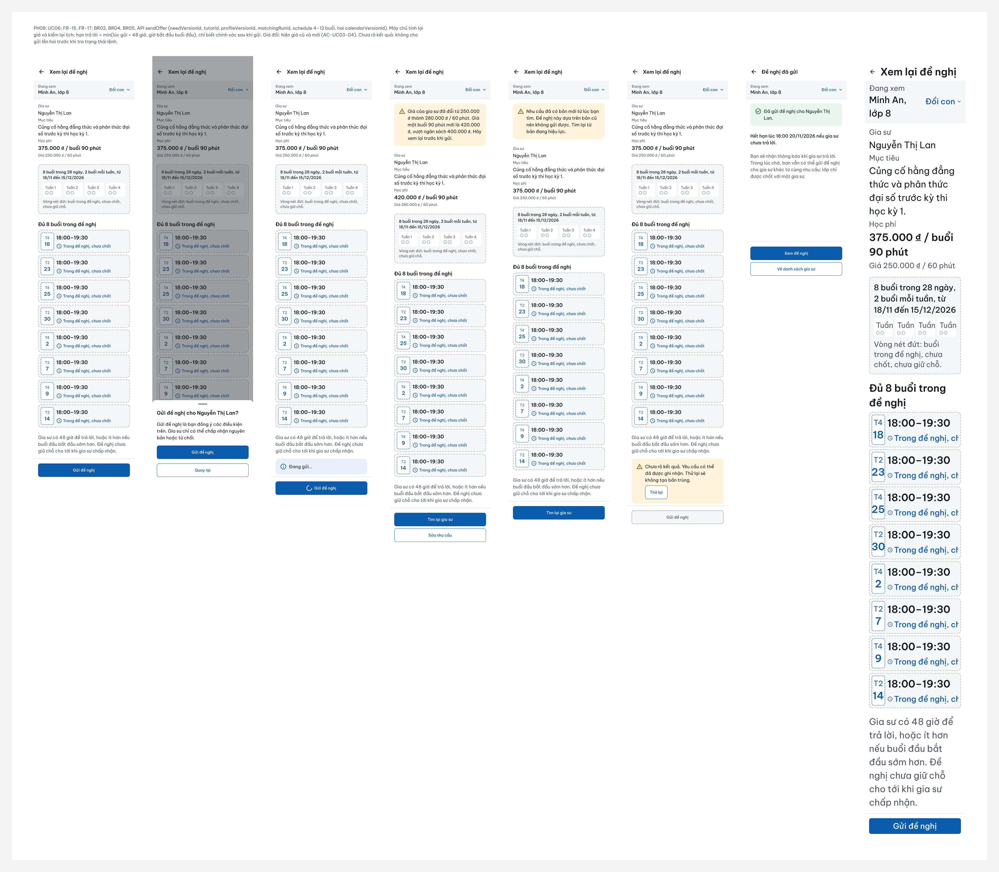

# PH08 Xem lại và gửi đề nghị

- **Trạng thái thiết kế:** Đã duyệt v1 (Đính, 10/11/2026)
- **Version Figma:** `Lát 1 v1 2026-11-10` (named version lưu tay trong Figma)
- **Node:** section [31:3916](https://www.figma.com/design/uuEo9SH3LxWcFbbHHFFBgl?node-id=31-3916)
- **Kênh:** Android
- **Route (đề xuất, Issue giao diện được chỉnh nếu xung đột router):** `/parent/needs/[needId]/offer`
- **Issue giao diện:** #72
- **Căn cứ:** UC06; FR-15, FR-17; BR02, BR04, BR05; đặc tả ở [06-man-hinh-lat-1.md](../06-man-hinh-lat-1.md)
- **API:** `sendOffer`

## Ảnh

Ảnh gồm mọi frame trạng thái của section theo thứ tự trong bảng dưới. Xem từng frame ở độ phân giải đầy đủ qua link node.

## Trạng thái

| Frame | Node |
|---|---|
| Gửi đề nghị / Xem lại | [31:2733](https://www.figma.com/design/uuEo9SH3LxWcFbbHHFFBgl?node-id=31-2733) |
| Gửi đề nghị / Xác nhận | [31:2871](https://www.figma.com/design/uuEo9SH3LxWcFbbHHFFBgl?node-id=31-2871) |
| Gửi đề nghị / Đang gửi | [31:3017](https://www.figma.com/design/uuEo9SH3LxWcFbbHHFFBgl?node-id=31-3017) |
| Gửi đề nghị / Giá hoặc lịch đã đổi | [31:3165](https://www.figma.com/design/uuEo9SH3LxWcFbbHHFFBgl?node-id=31-3165) |
| Gửi đề nghị / Nhu cầu là bản cũ | [31:3311](https://www.figma.com/design/uuEo9SH3LxWcFbbHHFFBgl?node-id=31-3311) |
| Gửi đề nghị / Chưa rõ kết quả | [31:3455](https://www.figma.com/design/uuEo9SH3LxWcFbbHHFFBgl?node-id=31-3455) |
| Gửi đề nghị / Đã gửi | [31:3601](https://www.figma.com/design/uuEo9SH3LxWcFbbHHFFBgl?node-id=31-3601) |
| Gửi đề nghị / Chữ 200% | [31:3634](https://www.figma.com/design/uuEo9SH3LxWcFbbHHFFBgl?node-id=31-3634) |

Trạng thái chung (tải, lỗi tải, mất quyền, hết phiên, đang gửi, chưa rõ kết quả) theo [04-trang-thai-cau-chu.md](../04-trang-thai-cau-chu.md) khi frame không vẽ riêng.

## Câu chữ

Nguyên văn trong Figma; câu chung lấy từ [04](../04-trang-thai-cau-chu.md). `{…}` là dữ liệu thật thay vào.

| Vị trí | Chuỗi |
|---|---|
| Mục | Gia sư / Mục tiêu / Học phí / Đủ 8 buổi trong đề nghị |
| Hạn | Gia sư có 48 giờ để trả lời, hoặc ít hơn nếu buổi đầu bắt đầu sớm hơn. Đề nghị chưa giữ chỗ cho tới khi gia sư chấp nhận. |
| Bảng xác nhận | Gửi đề nghị cho {gia sư}? Gửi đề nghị là bạn đồng ý các điều kiện trên. Gia sư chỉ có thể chấp nhận nguyên bản hoặc từ chối. |
| Giá đổi | Giá của gia sư đã đổi từ 250.000 ₫ thành 280.000 ₫ / 60 phút. Giá một buổi 90 phút mới là 420.000 ₫, vượt ngân sách 400.000 ₫. Hãy xem lại trước khi gửi. |
| Bản cũ | Nhu cầu đã có bản mới từ lúc bạn tìm. Đề nghị này dựa trên bản cũ nên không gửi được. Tìm lại từ bản đang hiệu lực. |
| Đã gửi | Đã gửi đề nghị cho {gia sư}. Hết hạn lúc 18:00 20/11/2026 nếu gia sư chưa trả lời. |
| Nút | Gửi đề nghị |

## Hành vi

- Lịch mẫu: 8 buổi Thứ 4 và Thứ 2 từ 18/11 đến 14/12/2026, đúng 2 buổi mỗi khối 7 ngày.
- Chưa rõ kết quả: không cho gửi lần hai trước khi tra trạng thái lệnh.

## Ánh xạ sang code

| Figma | Mobile |
|---|---|
| `TopAppBar` | Chưa có trong code, thêm ở Issue giao diện đầu tiên dùng nó (`shared/ui`) |
| `StudentSwitcher` | Chưa có trong code, thêm ở Issue giao diện đầu tiên dùng nó (`shared/ui`) |
| `PriceBlock` | Chưa có trong code, thêm ở Issue giao diện đầu tiên dùng nó (`shared/ui`) |
| `CycleStrip` | Chưa có trong code, thêm ở Issue giao diện đầu tiên dùng nó (`shared/ui`) |
| `SessionCard` | Chưa có trong code, thêm ở Issue giao diện đầu tiên dùng nó (`shared/ui`) |
| `ConfirmSheet` | Chưa có trong code, thêm ở Issue giao diện đầu tiên dùng nó (`shared/ui`) |
| `StickyActionBar` | Chưa có trong code, thêm ở Issue giao diện đầu tiên dùng nó (`shared/ui`) |
| `Notice` | `Notice.tsx` |

## Khác so với đặc tả và câu hỏi còn mở

- Code #72 PR 1 khác Figma v1 (29/11/2026):
  - Route `/parent/needs/[needId]/offer` nhận `runId` và `tutorId`: màn gửi đúng ứng viên của lượt gợi ý đó, mở từ "Gửi đề nghị" của PH07.
  - "Giá hoặc lịch đã đổi": máy chủ trả mã (`OFFER_TERMS_CHANGED`, `SCHEDULE_CONFLICT`, `MATCHING_RUN_EXPIRED`), không trả giá cũ và mới, nên dùng câu chung của [04](../04-trang-thai-cau-chu.md) "Giá hoặc lịch của gia sư đã thay đổi. Hãy xem lại trước khi gửi." thay cho câu có số của frame. Nút: "Tìm lại gia sư", "Sửa nhu cầu".
  - "Nhu cầu là bản cũ" khi máy chủ trả 412 hoặc `NEED_VERSION_CHANGED`, và ngay khi mở nếu lượt gợi ý thuộc version khác của nhu cầu.
  - Chưa rõ kết quả: "Gửi đề nghị" bị vô hiệu; "Thử lại" gửi lại cùng khóa, máy chủ trả lại đề nghị đầu tiên nếu nó đã được tạo. Tra `getCommandStatus` làm ở #75.
  - Chưa có `NavigationBar` (#205). Bảng chọn con như PH06.
