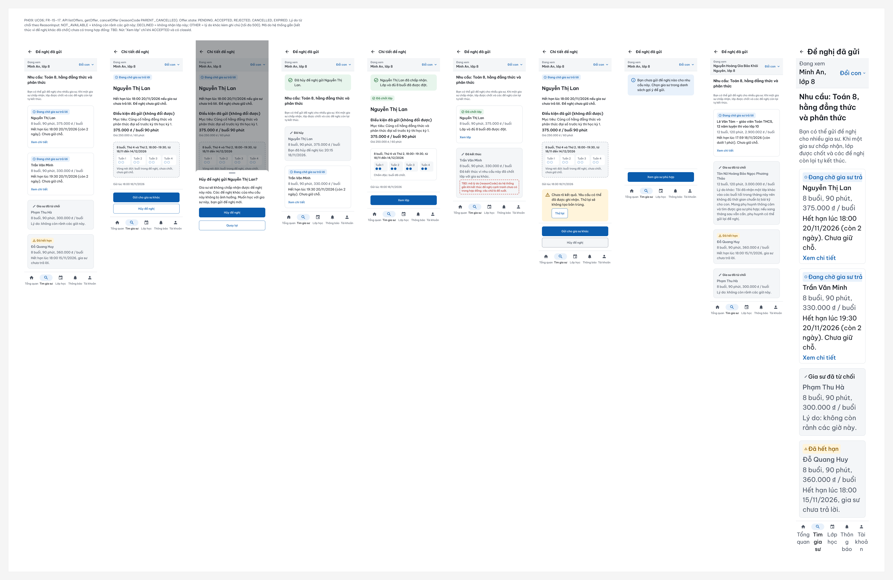

# PH09 Danh sách và chi tiết đề nghị

- **Trạng thái thiết kế:** Đã duyệt v1 (Đính, 10/11/2026); khung TBD chưa duyệt
- **Version Figma:** `Lát 1 v1 2026-11-10` (named version lưu tay trong Figma)
- **Node:** section [34:4229](https://www.figma.com/design/uuEo9SH3LxWcFbbHHFFBgl?node-id=34-4229)
- **Kênh:** Android
- **Route (đề xuất, Issue giao diện được chỉnh nếu xung đột router):** `/parent/needs/[needId]/offers`, `/parent/offers/[offerId]`
- **Issue giao diện:** #72
- **Căn cứ:** UC06; FR-15–17; đặc tả ở [06-man-hinh-lat-1.md](../06-man-hinh-lat-1.md)
- **API:** `listOffers`, `getOffer`, `cancelOffer` (PARENT_CANCELLED)

## Ảnh

Ảnh gồm mọi frame trạng thái của section theo thứ tự trong bảng dưới. Xem từng frame ở độ phân giải đầy đủ qua link node.

## Trạng thái

| Frame | Node |
|---|---|
| Đề nghị / Danh sách | [34:3306](https://www.figma.com/design/uuEo9SH3LxWcFbbHHFFBgl?node-id=34-3306) |
| Đề nghị / Chi tiết đang chờ | [34:3395](https://www.figma.com/design/uuEo9SH3LxWcFbbHHFFBgl?node-id=34-3395) |
| Đề nghị / Xác nhận hủy | [34:3484](https://www.figma.com/design/uuEo9SH3LxWcFbbHHFFBgl?node-id=34-3484) |
| Đề nghị / Đã hủy | [34:3582](https://www.figma.com/design/uuEo9SH3LxWcFbbHHFFBgl?node-id=34-3582) |
| Đề nghị / Đã chốt lớp | [34:3658](https://www.figma.com/design/uuEo9SH3LxWcFbbHHFFBgl?node-id=34-3658) |
| Đề nghị / Kết thúc vì lớp đã chốt | [34:3751](https://www.figma.com/design/uuEo9SH3LxWcFbbHHFFBgl?node-id=34-3751) |
| Đề nghị / Chưa rõ kết quả | [34:3821](https://www.figma.com/design/uuEo9SH3LxWcFbbHHFFBgl?node-id=34-3821) |
| Đề nghị / Rỗng | [34:3919](https://www.figma.com/design/uuEo9SH3LxWcFbbHHFFBgl?node-id=34-3919) |
| Đề nghị / Dữ liệu xấu nhất | [34:3976](https://www.figma.com/design/uuEo9SH3LxWcFbbHHFFBgl?node-id=34-3976) |
| Đề nghị / Chữ 200% | [34:4062](https://www.figma.com/design/uuEo9SH3LxWcFbbHHFFBgl?node-id=34-4062) |

Trạng thái chung (tải, lỗi tải, mất quyền, hết phiên, đang gửi, chưa rõ kết quả) theo [04-trang-thai-cau-chu.md](../04-trang-thai-cau-chu.md) khi frame không vẽ riêng.

## Câu chữ

Nguyên văn trong Figma; câu chung lấy từ [04](../04-trang-thai-cau-chu.md). `{…}` là dữ liệu thật thay vào.

| Vị trí | Chuỗi |
|---|---|
| Nhãn | Đang chờ gia sư trả lời / Đã chốt lớp / Gia sư đã từ chối / Đã hủy / Đã hết hạn / Đã kết thúc |
| Lý do | Lý do: không còn rảnh các giờ này. / không nhận lớp này. / Lý do khác: {ghi chú} |
| Chi tiết | Điều kiện đã gửi (không đổi được). Nút chính: Gửi cho gia sư khác; nút phụ: Hủy đề nghị |
| Bảng hủy | Hủy đề nghị gửi {gia sư}? Gia sư sẽ không chấp nhận được đề nghị này nữa. Các đề nghị khác của nhu cầu này không bị ảnh hưởng. |
| Đã chốt | {gia sư} đã chấp nhận. Lớp và đủ 8 buổi đã được đặt. Nút: Xem lớp |
| Kết thúc | Đã kết thúc vì nhu cầu này đã chốt lớp với gia sư khác. |

## Hành vi

- "Xem lớp" chỉ khi ACCEPTED và có classId.

## Ánh xạ sang code

| Figma | Mobile |
|---|---|
| `TopAppBar` | Chưa có trong code, thêm ở Issue giao diện đầu tiên dùng nó (`shared/ui`) |
| `StudentSwitcher` | Chưa có trong code, thêm ở Issue giao diện đầu tiên dùng nó (`shared/ui`) |
| `StatusLabel` | Chưa có trong code, thêm ở Issue giao diện đầu tiên dùng nó (`shared/ui`) |
| `PriceBlock` | Chưa có trong code, thêm ở Issue giao diện đầu tiên dùng nó (`shared/ui`) |
| `CycleStrip` | Chưa có trong code, thêm ở Issue giao diện đầu tiên dùng nó (`shared/ui`) |
| `ConfirmSheet` | Chưa có trong code, thêm ở Issue giao diện đầu tiên dùng nó (`shared/ui`) |
| `StickyActionBar` | Chưa có trong code, thêm ở Issue giao diện đầu tiên dùng nó (`shared/ui`) |
| `Notice` | `Notice.tsx` |
| `NavigationBar` | Chưa có trong code, thêm ở Issue giao diện đầu tiên dùng nó (`shared/ui`) |

## Khác so với đặc tả và câu hỏi còn mở

- Mã lý do do hệ thống gắn: backend ghi `NEED_CLOSED` khi đề nghị kết thúc vì nhu cầu đã chốt với gia sư khác (`Offer.reasonCode` là chuỗi tự do). Nhãn "Đã kết thúc", câu Figma "Đã kết thúc vì nhu cầu này đã chốt lớp với gia sư khác."
- Câu chữ Đính chốt ngày 29/11/2026 (#72):
  - `OTHER`: "Lý do: lý do khác." Lát 1 không lưu ghi chú (#231).
  - `PARENT_CANCELLED`: "Bạn đã hủy đề nghị này." `Offer` không có thời điểm hủy, nên bỏ giờ của frame.
  - Đề nghị đang chờ: "(còn n ngày)" làm tròn xuống, dưới 1 ngày "(còn n giờ)", dưới 1 giờ "(còn dưới 1 giờ)".
  - Mã app chưa biết: chỉ hiện nhãn, không có dòng lý do.
- Code #72 PR 2 khác Figma v1 (29/11/2026):
  - Route chi tiết `/parent/offers/[offerId]`. Hủy xong thì về danh sách của nhu cầu, danh sách hiện "Đã hủy đề nghị gửi {gia sư}."
  - `listOffers` không lọc theo nhu cầu: app đọc mọi trang rồi giữ đề nghị của nhu cầu này.
  - Gia sư đã ẩn hồ sơ công khai không còn tên để hiện: thẻ ghi "Gia sư".
  - Đề nghị đã trả lời hoặc hết hạn trong lúc phụ huynh xem (409 `OFFER_NOT_PENDING`, `OFFER_EXPIRED`): đọc lại và hiện như hiện tại, kèm câu của máy chủ.
  - Đề nghị đã kết thúc (từ chối, hết hạn, hủy): nút "Gửi cho gia sư khác", không có "Hủy đề nghị".
  - Chưa có `NavigationBar` (#205). Bảng chọn con như PH06.
